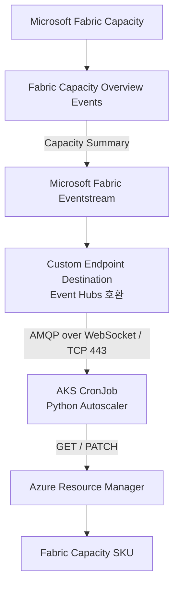
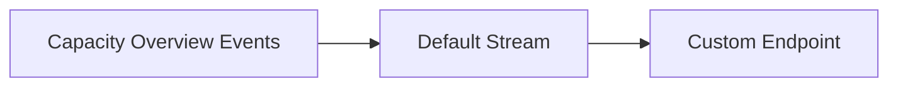

# Microsoft Fabric Dynamic Autoscale — Eventstream 및 Event Hub 연결 구성 가이드

## 1. 개요

이 문서는 Microsoft Fabric Capacity Dynamic Autoscale 구현을 위해 Fabric에서 Capacity Summary 이벤트를 활성화하고, AKS Autoscaler가 이벤트를 수신할 수 있도록 Eventstream Custom Endpoint를 구성하는 방법을 설명합니다.

본 가이드는 **Fabric Eventstream에서 제공하는 Event Hubs 호환 Custom Endpoint를 직접 사용하는 구성**을 기준으로 합니다.

별도의 Azure Event Hubs Namespace를 생성하는 방식과는 구분됩니다.

### 구성 아키텍처



### 구성 요소

| 구성 요소 | 역할 | 생성 위치 |
|---|---|---|
| Fabric Capacity | 사용률 이벤트 발생 대상 | Azure / Fabric |
| Fabric Workspace | Eventstream 관리 | Microsoft Fabric |
| Capacity Overview Events | Capacity 사용률 이벤트 소스 | Fabric Real-Time Hub |
| Eventstream | 이벤트 수집 및 전달 | Microsoft Fabric |
| Custom Endpoint | AKS에서 이벤트를 수신하는 연결 지점 | Eventstream Destination |
| AKS CronJob | 사용률 분석 및 Autoscale 실행 | Azure Kubernetes Service |
| Azure ARM API | Capacity 상태 조회 및 SKU 변경 | Azure Resource Manager |

## 2. 사전 요구사항

구성 전에 다음 항목을 확인합니다.

- Microsoft Fabric Capacity가 존재하고 활성화되어 있어야 합니다.
- Eventstream을 생성할 Fabric Workspace가 필요합니다.
- 해당 Workspace에 Contributor 이상의 권한이 필요합니다.
- 이벤트를 수집할 Fabric Capacity에 적절한 관리 권한이 필요합니다.
- AKS에서 Fabric Custom Endpoint로 TCP 443 통신이 가능해야 합니다.
- AKS에서 Azure ARM API에 접근할 수 있어야 합니다.
- Microsoft Entra ID 인증을 사용하는 경우 해당 ID에 필요한 Fabric Workspace 접근 권한이 부여되어야 합니다.

Fabric Capacity Overview Events의 생성과 권한 요구사항은 Microsoft 공식 문서를 참고합니다.

[Microsoft Learn — Fabric Capacity Overview Events](https://learn.microsoft.com/en-us/fabric/real-time-hub/create-streams-fabric-capacity-overview-events)

## 3. Fabric Capacity Overview Events 설정

### 3.1 Real-Time Hub 접근

1. [Microsoft Fabric](https://app.fabric.microsoft.com/)에 로그인합니다.
2. 왼쪽 메뉴에서 **Real-Time**으로 이동합니다.
3. **Real-Time Hub**를 엽니다.
4. **Fabric events** 메뉴를 선택합니다.
5. **Capacity overview events**를 찾습니다.
6. `Create Eventstream`을 선택합니다.

화면 구성에 따라 Real-Time Hub의 `Add data` → `Fabric events` → `Capacity overview events` 경로로도 생성할 수 있습니다.

### 3.2 이벤트 유형 선택

다음 이벤트를 선택합니다.

```text
Microsoft.Fabric.Capacity.Summary
```

이 이벤트는 Fabric Capacity의 사용량을 30초 단위로 요약합니다.

추가로 다음 이벤트도 제공됩니다.

```text
Microsoft.Fabric.Capacity.State
```

State 이벤트는 Capacity의 상태 변경을 나타냅니다.

Dynamic Autoscale의 사용률 계산에는 `Capacity.Summary`가 필요합니다. `Capacity.State`는 별도의 상태 모니터링 목적에 사용할 수 있습니다.

### 3.3 Capacity 선택

`Event scope`에서 **Fabric capacity**를 선택하고 모니터링할 Capacity를 지정합니다.

이후 Eventstream이 생성될 Workspace와 Eventstream 이름을 설정합니다.

예시:

```text
Workspace        : example-monitoring-workspace
Eventstream Name : es-fabric-capacity-monitor
Source Name      : fabric-capacity-overview
Event Type       : Microsoft.Fabric.Capacity.Summary
```

위 값은 설명용 예시이며 실제 리소스 이름은 환경에 맞게 지정합니다.

### 3.4 생성 결과 확인

생성 후 다음 항목을 확인합니다.

1. 지정한 Workspace에 Eventstream이 생성되었는지 확인합니다.
2. Eventstream을 열어 Capacity Overview Events 원본이 연결되었는지 확인합니다.
3. 이벤트 미리보기에서 데이터가 수신되는지 확인합니다.
4. 이벤트의 `type`이 `Microsoft.Fabric.Capacity.Summary`인지 확인합니다.

**주의:** Microsoft 공식 문서에 따르면 Capacity가 Active 상태라도 해당 30초 구간의 모든 지표가 0이면 Summary 이벤트가 발생하지 않을 수 있습니다. 따라서 이벤트 수가 부족하다는 이유만으로 Eventstream 장애라고 단정해서는 안 됩니다.

공식 문서:

[Microsoft Learn — Capacity Overview Events Schema](https://learn.microsoft.com/en-us/fabric/real-time-hub/explore-fabric-capacity-overview-events)

## 4. Eventstream Custom Endpoint 생성

### 4.1 Destination 추가

1. 생성한 Eventstream을 엽니다.
2. `Edit` 모드로 전환합니다.
3. `Add destination`을 선택합니다.
4. **Custom endpoint**를 선택합니다.
5. Destination 이름을 입력합니다.

예시:

```text
Destination Name : fabric-autoscale-consumer
Destination Type : Custom endpoint
```

### 4.2 이벤트 연결

Eventstream의 Default Stream과 Custom Endpoint Destination을 연결합니다.



별도의 이벤트 변환이 필요하지 않다면 원본 이벤트의 필드 구조가 유지되도록 구성합니다.

특히 Python Autoscaler가 다음 구조를 처리하는 경우:

```json
{
  "type": "Microsoft.Fabric.Capacity.Summary",
  "data": {
    "capacityName": "example-capacity",
    "baseCapacityUnits": 16,
    "capacityUnitMs": 240000,
    "windowStartTime": "2026-10-20T05:00:00Z",
    "windowEndTime": "2026-10-20T05:00:30Z"
  }
}
```

`type`과 `data` 구조가 변경되지 않아야 합니다.

위 JSON은 필드 설명을 위한 예시이며 실제 이벤트의 전체 스키마를 나타내지는 않습니다.

### 4.3 Eventstream 게시

Custom Endpoint 연결이 완료되면 **Publish**를 선택합니다.

게시 이후 Live View에서 Custom Endpoint가 표시되는지 확인합니다.

공식 문서:

[Microsoft Learn — Custom Endpoint Destination 추가](https://learn.microsoft.com/en-us/fabric/real-time-intelligence/event-streams/add-destination-custom-app)

## 5. Event Hub 연결정보 확인

Custom Endpoint는 Azure Event Hubs SDK에서 사용할 수 있는 Event Hubs 호환 연결정보를 제공합니다.

### 5.1 연결정보 확인 위치

1. Eventstream의 Live View를 엽니다.
2. 생성한 Custom Endpoint를 선택합니다.
3. 오른쪽 Details 패널을 확인합니다.
4. **Event Hub** 프로토콜 탭을 선택합니다.
5. **Entra ID Authentication**을 선택합니다.

이 화면에서 다음 정보를 확인합니다.

| 항목 | Python SDK 설정 |
|---|---|
| Event hub namespace | `fully_qualified_namespace` |
| Event hub | `eventhub_name` |
| Consumer group | `consumer_group` |

예시:

```text
Event Hub Namespace : eventstream-example.servicebus.windows.net
Event Hub Name      : es_example
Consumer Group      : $Default
```

**실제 Namespace와 Event Hub 이름은 반드시 Custom Endpoint Details 화면에서 확인한 값을 사용해야 합니다.**

Azure Portal에서 별도의 Event Hubs Namespace를 생성할 필요는 없습니다.

### 5.2 연결 방식

Python Autoscaler에서는 다음 SDK를 사용합니다.

```python
from azure.eventhub import EventHubConsumerClient, TransportType
from azure.identity import DefaultAzureCredential

client = EventHubConsumerClient(
    fully_qualified_namespace=EVENTHUB_NAMESPACE,
    eventhub_name=EVENTHUB_NAME,
    consumer_group=CONSUMER_GROUP,
    credential=DefaultAzureCredential(),
    transport_type=TransportType.AmqpOverWebsocket,
)
```

이 연결은 Event Hubs 프로토콜을 사용하지만, 연결 대상은 Fabric Eventstream Custom Endpoint입니다.

공식 문서:

[Microsoft Learn — Custom Endpoint Entra ID 인증](https://learn.microsoft.com/en-us/fabric/real-time-intelligence/event-streams/custom-endpoint-entra-id-auth)

## 6. Microsoft Entra ID 인증 및 권한 설정

Dynamic Autoscale은 AKS Workload Identity를 사용하여 인증하도록 설계할 수 있습니다.

### 6.1 Fabric Workspace 권한

Custom Endpoint의 Entra ID 인증을 사용하려면 AKS에서 사용하는 서비스 주체 또는 관리 ID에 적절한 Fabric Workspace 접근 권한이 필요합니다.

설정 경로:

```text
Microsoft Fabric
  → Workspace
  → Manage access
  → Add people or groups
  → 서비스 주체 또는 관리 ID 선택
  → 권한 부여
```

Microsoft 공식 가이드에서는 서비스 주체를 이용한 Custom Endpoint 소비 예시에서 Contributor 이상의 Workspace 권한을 부여합니다.

운영환경에서는 필요한 권한을 검증한 후 최소 권한 원칙을 적용해야 합니다.

### 6.2 Fabric Tenant 설정

Microsoft 공식 문서에서는 서비스 주체 기반 Eventstream 인증을 위해 관련 Tenant 설정을 확인하도록 안내합니다.

확인 경로:

```text
Microsoft Fabric
  → Settings
  → Admin portal
  → Tenant settings
  → Developer settings
```

확인 대상:

```text
Service principals can use Fabric APIs
```

이 설정은 조직 보안 정책에 따라 허용된 서비스 주체 또는 보안 그룹에만 적용하는 것이 적절합니다.

### 6.3 Azure ARM 권한

Eventstream 데이터를 읽는 권한과 Fabric Capacity SKU를 변경하는 권한은 별개입니다.

AKS Workload Identity가 사용하는 ID에는 대상 Capacity에 대해 ARM GET 및 PATCH 작업을 수행할 수 있는 권한이 필요합니다.

```text
Microsoft.Fabric/capacities/read
Microsoft.Fabric/capacities/write
```

권한은 가능한 한 대상 Capacity 리소스 범위로 제한합니다.

## 7. AKS 환경변수 연결

Custom Endpoint에서 확인한 연결정보를 AKS CronJob에 전달합니다.

기존 Autoscaler 코드에서 사용하는 환경변수 예시:

```text
Fabric-Event-Hub-namespace-endpoint
Fabric-Event-Hub-name
Fabric-Event-Hub-Consumer-group
```

설정값 예시:

```text
Fabric-Event-Hub-namespace-endpoint = eventstream-example.servicebus.windows.net
Fabric-Event-Hub-name               = es_example
Fabric-Event-Hub-Consumer-group     = $Default
```

**주의:** 기존 코드와 새로 설계한 Policy Controller의 환경변수 이름은 서로 다를 수 있습니다. 실제 배포 시에는 실행하는 Python 코드의 설정명과 Kubernetes 환경변수 이름이 일치해야 합니다.

## 8. 네트워크 요구사항

AKS에서 Eventstream Custom Endpoint로 연결하기 위해 다음 아웃바운드 통신이 필요합니다.

| 항목 | 설정 |
|---|---|
| 통신 방향 | AKS → Custom Endpoint |
| 프로토콜 | AMQP over WebSocket / TLS |
| 포트 | TCP 443 |
| 인증 | Microsoft Entra ID |
| SDK | `azure-eventhub` |

Azure Resource Manager와 Microsoft Entra ID 토큰 발급 Endpoint에 대한 접근도 필요합니다.

### 연결 확인

AKS Pod 내부에서 DNS 조회 및 TCP 연결을 확인합니다.

```bash
nslookup <eventhub-namespace>
```

```bash
curl -v --connect-timeout 10 https://<eventhub-namespace>/
```

HTTP 응답 코드가 200이 아니더라도 DNS와 TLS 연결이 성립할 수 있습니다. 위 명령은 네트워크 연결 확인용이며, 실제 Event Hubs 인증 및 이벤트 수신 성공을 의미하지 않습니다.

최종 검증은 Python SDK를 이용한 이벤트 수신으로 수행해야 합니다.

## 9. Capacity Summary 이벤트 수신 검증

### 9.1 Eventstream 확인

Fabric Eventstream의 Live View에서 이벤트가 지속적으로 유입되는지 확인합니다.

검증 대상:

```text
type = Microsoft.Fabric.Capacity.Summary
```

### 9.2 이벤트 필드 확인

Dynamic Autoscale에 필요한 주요 필드는 다음과 같습니다.

| 필드 | 용도 |
|---|---|
| `capacityName` | 대상 Capacity 구분 |
| `baseCapacityUnits` | Capacity CU 기준값 |
| `capacityUnitMs` | 사용된 CUms |
| `windowStartTime` | 사용률 계산 구간 시작 |
| `windowEndTime` | 사용률 계산 구간 종료 |

### 9.3 AKS 수신 검증

AKS CronJob 실행 로그에서 다음을 확인합니다.

- Event Hub 연결 오류가 발생하지 않는지
- Capacity Summary 이벤트가 수신되는지
- 대상 Capacity 이름이 일치하는지
- 14분 조회 범위에 해당하는 이벤트가 존재하는지
- Rolling Average 계산에 필요한 데이터가 충분한지

단, Fabric의 Summary 이벤트 발생 특성상 일부 구간에 이벤트가 없을 수 있으므로 데이터 완전성 판단은 구현 정책에 따라 처리해야 합니다.

## 10. Autoscale 동작 검증

이벤트 수신이 정상이라면 다음 단계로 실제 Autoscale 판단을 검증합니다.

| 검증 항목 | 기대 결과 |
|---|---|
| 평일 운영시간 이내 | Autoscale 평가 진행 |
| 운영시간 외 | SKIP |
| 주말 | SKIP |
| Capacity 비활성 상태 | SKIP |
| Rolling 데이터 부족 | SKIP |
| 5개 평균 모두 80% 초과 | Scale Up 후보 |
| 5개 평균 모두 40% 미만 | Scale Down 후보 |
| 임계값 조건 미충족 | MAINTAIN |
| SKU 최대·최소 범위 도달 | MAINTAIN |
| ARM PATCH 성공 | 변경 요청 접수 |
| SKU 변경 완료 | ARM GET 재조회로 확인 |

실제 SKU 변경 테스트 전에는 Dry-run 또는 Read-Only 분석을 먼저 수행하는 것을 권장합니다.

## 11. 별도 Azure Event Hubs를 사용하는 경우

Fabric Custom Endpoint 대신 Azure Portal에서 별도의 Azure Event Hubs 리소스를 생성하는 구성도 가능합니다.

다만 이 경우 **Fabric Eventstream에서 Azure Event Hubs로 이벤트를 전달하는 별도 지원 경로 또는 중간 전달 애플리케이션**이 필요합니다.

Azure Event Hubs 리소스 생성 자체만으로 Fabric Capacity Summary 이벤트가 자동 전달되지는 않습니다.

별도 Azure Event Hubs를 사용하는 경우 일반적으로 다음 항목을 구성해야 합니다.

```text
Azure Subscription
  → Event Hubs Namespace
  → Event Hub
  → Consumer Group
  → 수신 ID 권한
  → AKS EventHubConsumerClient 연결
```

하지만 Fabric Eventstream에서 별도 Azure Event Hubs로 전달하는 방법은 이 가이드의 범위에 포함하지 않습니다.

## 12. 최종 구성 체크리스트

- [ ] Fabric Workspace 접근 권한 확인
- [ ] 대상 Fabric Capacity 관리 권한 확인
- [ ] Real-Time Hub에서 Capacity Overview Events 선택
- [ ] `Microsoft.Fabric.Capacity.Summary` 이벤트 선택
- [ ] 대상 Capacity 지정
- [ ] Eventstream 생성
- [ ] Custom Endpoint Destination 추가
- [ ] Default Stream과 Custom Endpoint 연결
- [ ] Eventstream Publish
- [ ] Custom Endpoint의 Event Hub 연결정보 확인
- [ ] AKS Workload Identity 및 Fabric Workspace 권한 설정
- [ ] ARM Capacity 변경 권한 설정
- [ ] AKS에서 TCP 443 통신 확인
- [ ] Capacity Summary 이벤트 수신 확인
- [ ] Rolling Average 계산 검증
- [ ] Dry-run Autoscale 판단 검증
- [ ] 실제 SKU 변경 및 완료 상태 검증

---

## 13. Microsoft 공식 참고 문서

1. [Fabric Capacity Overview Events 생성](https://learn.microsoft.com/en-us/fabric/real-time-hub/create-streams-fabric-capacity-overview-events)
2. [Capacity Overview Events 스키마 및 이벤트 유형](https://learn.microsoft.com/en-us/fabric/real-time-hub/explore-fabric-capacity-overview-events)
3. [Eventstream Custom Endpoint Destination 추가](https://learn.microsoft.com/en-us/fabric/real-time-intelligence/event-streams/add-destination-custom-app)
4. [Custom Endpoint Microsoft Entra ID 인증](https://learn.microsoft.com/en-us/fabric/real-time-intelligence/event-streams/custom-endpoint-entra-id-auth)
5. [Eventstream Destination 관리](https://learn.microsoft.com/en-us/fabric/real-time-intelligence/event-streams/add-manage-eventstream-destinations)