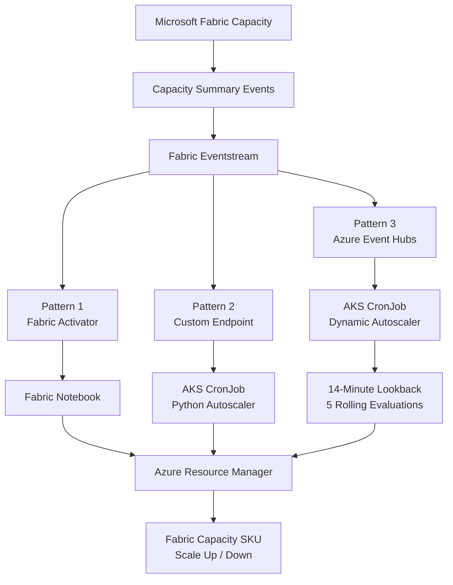
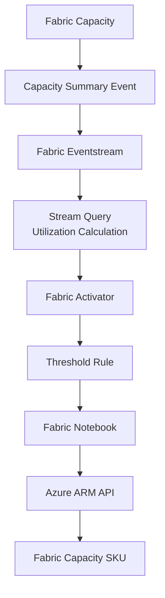
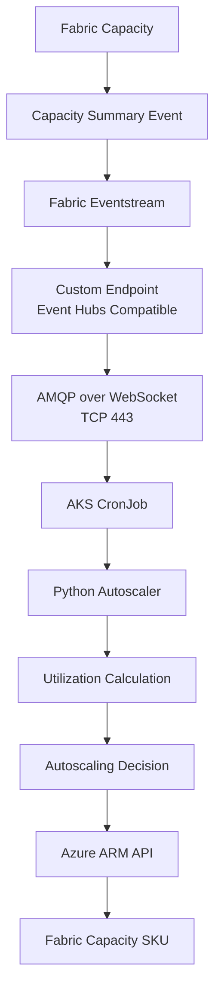
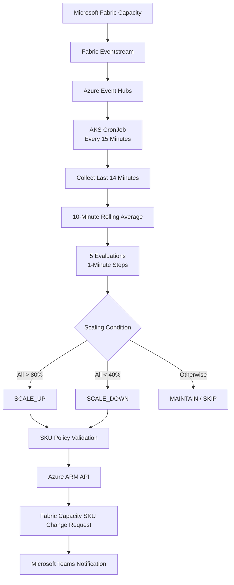
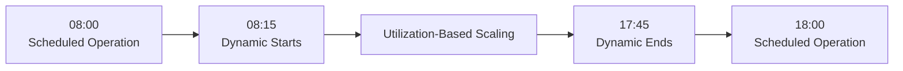
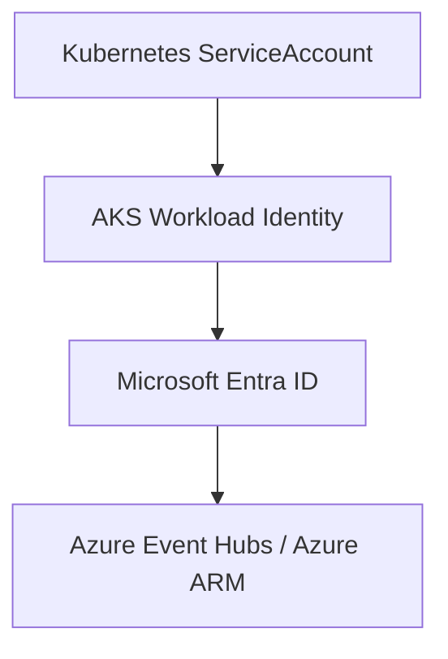
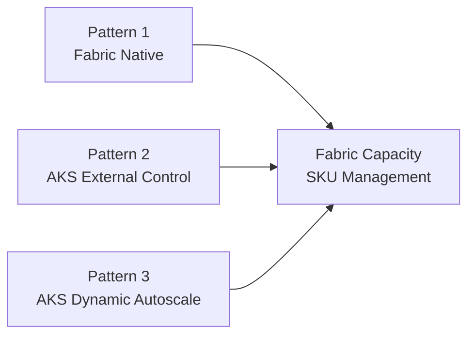

# Microsoft Fabric Capacity Autoscaling Patterns

**한국어** | [English](README.ko.md)

본 Repository는 **Microsoft Fabric Capacity의 사용량을 기반으로 Fabric SKU를 자동 조정하는 Autoscaling 아키텍처 및 POC 구현 패턴**을 정리한 프로젝트입니다.

Microsoft Fabric Real-Time Intelligence에서 제공하는 Capacity Event를 기반으로 다음 세 가지 방식을 구성하고 비교합니다.

1. **Pattern 1 — Eventstream + Activator + Notebook**
2. **Pattern 2 — Eventstream Custom Endpoint + AKS CronJob**
3. **Pattern 3 — Event Hubs + AKS Dynamic Autoscale**

세 가지 방식 모두 Fabric Capacity Event를 사용량 지표로 활용하지만, **사용률을 분석하고 Autoscaling 조건을 판단하는 위치와 실행 방식이 다릅니다.**

---

## 1. Overview

Microsoft Fabric Capacity에서는 Capacity 사용량과 상태 정보를 Event 형태로 제공할 수 있습니다.

본 프로젝트에서는 다음 Event Type을 주요 Autoscaling Metric Source로 사용합니다.

```text
Microsoft.Fabric.Capacity.Summary
```

Capacity Summary Event에는 다음과 같은 정보가 포함될 수 있습니다.

```text
capacityName
capacitySku
capacityRegion
baseCapacityUnits
capacityUnitMs
windowStartTime
windowEndTime
utilizationBackground
utilizationInteractive
interactiveDelayThresholdPercentage
interactiveRejectionThresholdPercentage
backgroundRejectionThresholdPercentage
overageTotalCapacityUnitMs
```

해당 데이터를 활용하여 Fabric Capacity Utilization을 계산하고, 환경별 정책에 따라 Scale Up / Scale Down 여부를 결정합니다.

### Autoscaling Patterns

| 구분 | Pattern 1 | Pattern 2 | Pattern 3 |
|---|---|---|---|
| 아키텍처 | Activator + Notebook | Custom Endpoint + AKS | Event Hubs + AKS Dynamic Autoscale |
| 사용률 계산 | Fabric Eventstream | Python | Python |
| Scaling 판단 | Fabric Activator | Python | Python Rolling Average |
| 실행 방식 | Event-driven | Scheduled One-Shot | Scheduled One-Shot |
| Control Plane | Microsoft Fabric | AKS | AKS |
| Capacity 변경 | Azure ARM API | Azure ARM API | Azure ARM API |
| 주요 특징 | Fabric Native | External Control Plane | 운영 정책 기반 Dynamic Scaling |

---

## 2. Architecture Patterns

세 가지 패턴은 동일한 Fabric Capacity Summary Event를 기반으로 구성됩니다.



### Architecture Comparison

| 항목 | Pattern 1 | Pattern 2 | Pattern 3 |
|---|---|---|---|
| Metric Source | Capacity Summary Event | Capacity Summary Event | Capacity Summary Event |
| Event Processing | Eventstream | Eventstream | Eventstream |
| Event Consumer | Activator | AKS Python | AKS Python |
| Scaling Trigger | Activator Rule | CronJob | CronJob |
| Utilization Evaluation | Activator Window | Application Logic | 10분 평균 × 5 Step |
| ARM API 실행 위치 | Notebook | AKS | AKS |
| Kubernetes 필요 | 아니요 | 예 | 예 |
| Notebook Session 필요 | 예 | 아니요 | 아니요 |
| 운영 시간 정책 | Rule 구성에 따름 | 구현 정책에 따름 | 평일 08:15–17:45 KST |
| Teams 알림 | 구현에 따름 | 구현에 따름 | 지원 |

Pattern 2와 Pattern 3는 모두 AKS 기반이지만, **Pattern 3는 운영 시간, Rolling Average, 연속 임계값, 환경별 SKU 범위 및 Teams 알림을 포함한 구체적인 Dynamic Autoscale 구현**에 초점을 맞춥니다.

---

## 3. Pattern 1 — Eventstream + Activator + Notebook

📁 [`Fabric Eventstream Activator Notebook`](./Fabric%20Eventstream%20Activator%20Notebook/)

Microsoft Fabric 내부의 Real-Time Intelligence 기능을 중심으로 Autoscaling을 구성하는 방식입니다.



Eventstream에서 `Microsoft.Fabric.Capacity.Summary` Event를 처리하고 Utilization을 계산합니다.

Activator에서는 다음과 같은 Window 기반 Rule을 사용할 수 있습니다.

```text
Window Size  : 10분
Step Size    : 1분
Time Elapsed : 5분
```

Threshold 예시:

```text
Scale Up   : Utilization > 60%
Scale Down : Utilization < 30%
```

조건이 지정된 시간 동안 지속되면 Activator가 Fabric Notebook을 실행합니다.

Notebook은 Activator Parameter를 수신하고, 현재 Capacity 상태 및 SKU를 확인한 후 Azure ARM API를 통해 SKU 변경을 요청합니다.

### 주요 특징

- Fabric Native Architecture 중심의 Autoscaling
- Event-driven 방식의 Threshold 평가
- Activator Window / Step / Time Elapsed 활용
- 별도 Kubernetes Event Consumer 불필요
- Fabric Notebook을 통한 Azure ARM API 호출
- Notebook Session 초기화 시간 고려 필요

---

## 4. Pattern 2 — Eventstream Custom Endpoint + AKS CronJob

📁 [`Fabric Eventstream Custom Endpoint`](./Fabric%20Eventstream%20Custom%20Endpoint/)

Autoscaling Control Plane을 Microsoft Fabric 외부의 AKS로 분리하는 방식입니다.

Fabric Eventstream은 Capacity Event를 제공하며, AKS CronJob에서 Event Hubs-compatible Custom Endpoint를 통해 Event를 수신하고 Autoscaling 로직을 수행합니다.



Custom Endpoint 연결에 필요한 주요 정보는 다음과 같습니다.

```text
Event Hub Namespace Endpoint
Event Hub Name
Consumer Group
```

Azure Event Hubs Python SDK 연결 예시:

```python
client = EventHubConsumerClient(
    fully_qualified_namespace=EVENTHUB_NAMESPACE,
    eventhub_name=EVENTHUB_NAME,
    consumer_group=CONSUMER_GROUP,
    credential=DefaultAzureCredential(),
    transport_type=TransportType.AmqpOverWebsocket,
)
```

CronJob은 상시 실행 Consumer가 아닌 **One-Shot Batch 방식**으로 동작합니다.

### 주요 특징

- Autoscaling Control Plane을 Fabric 외부로 분리
- 기존 AKS CronJob 운영체계 활용
- Fabric Notebook Session 불필요
- Microsoft Entra ID / AKS Workload Identity 인증
- Event Hubs-compatible Custom Endpoint 활용
- AMQP over WebSocket / TCP 443 통신
- Python 기반 Autoscaling Policy 구현 가능

---

## 5. Pattern 3 — Event Hubs + AKS Dynamic Autoscale

📁 [`Fabric Eventhub Dynamic Autoscale`](./Fabric%20Eventhub%20Dynamic%20Autoscale/)

**Pattern 3는 Fabric Capacity 사용률을 주기적으로 분석하여 운영 정책에 따라 Capacity SKU를 자동으로 변경하는 Dynamic Autoscale 구현입니다.**

Pattern 2와 마찬가지로 AKS에서 실행하지만, 실제 운영을 고려한 시간 제어와 연속 사용률 분석 로직이 추가되어 있습니다.

### Architecture



### 운영 정책

| 항목 | 설정 |
|---|---|
| 운영 요일 | 월요일~금요일 |
| 운영 시간 | 08:15–17:45 KST |
| CronJob 실행 주기 | 15분 |
| 주말 | Dynamic Autoscale 미운영 |
| 데이터 조회 범위 | 최근 14분 |
| Rolling Window | 10분 |
| Step Size | 1분 |
| 연속 평가 횟수 | 5회 |
| Scale Up | 5개 평균 모두 80% 초과 |
| Scale Down | 5개 평균 모두 40% 미만 |
| 조건 미충족 | MAINTAIN |
| 데이터 부족 | SKIP |
| STG | F8 ↔ F16 |
| PRD | F16 ↔ F32 |
| SKU 변경 단위 | 한 단계씩 |
| 알림 | Microsoft Teams |

### Rolling Average

예를 들어 15:00 KST에 CronJob이 실행되면 최근 14분 데이터를 이용해 다음과 같이 계산합니다.

| Step | Window Start | Window End |
|---|---|---|
| 1 | 14:46 | 14:56 |
| 2 | 14:47 | 14:57 |
| 3 | 14:48 | 14:58 |
| 4 | 14:49 | 14:59 |
| 5 | 14:50 | 15:00 |

5개 Step의 평균 사용률이 모두 80%를 초과하면 Scale Up, 모두 40% 미만이면 Scale Down을 판단합니다.

CronJob 실행 주기는 15분이며, 1분 Step은 **한 번의 CronJob 실행 내부에서 계산하는 Rolling Average 간격**입니다.

### Operating Schedule



Dynamic Autoscale 운영 시간은 별도로 구성된 Schedule 기반 Capacity 관리 작업과의 충돌 위험을 줄이기 위해 설정되었습니다.

### Pattern 3 Documentation

- [Dynamic Autoscale Guide — English](./Fabric%20Eventhub%20Dynamic%20Autoscale/README.md)
- [Dynamic Autoscale Guide — 한국어](./Fabric%20Eventhub%20Dynamic%20Autoscale/README.ko.md)

상세한 사용률 계산, 운영 정책, 배포 구성, Teams 알림 및 검증 방법은 위 문서를 참고하세요.

---

## 6. Capacity Utilization Calculation

세 가지 패턴 모두 Fabric Capacity Summary Event의 사용량 정보를 기반으로 Utilization을 계산합니다.

### Formula

```text
Capacity Budget (CUms)
    = baseCapacityUnits × Window Duration (ms)

Utilization (%)
    = capacityUnitMs / Capacity Budget × 100
```

30초 Window 기준:

```text
Utilization (%)
    = capacityUnitMs / (baseCapacityUnits × 30,000) × 100
```

### Example

```text
baseCapacityUnits = 32
capacityUnitMs    = 465,000
Window            = 30 seconds

Capacity Budget = 32 × 30,000
                = 960,000 CUms

Utilization = 465,000 / 960,000 × 100
            = 48.44%
```

Pattern 3는 이 Event 단위 Utilization을 이용하여 10분 Rolling Average를 계산합니다.

---

## 7. SKU Ladder and Scaling Policies

Fabric Capacity SKU는 다음과 같은 순서로 구성할 수 있습니다.

```text
F2 → F4 → F8 → F16 → F32 → F64
```

Autoscaling 시에는 환경별로 허용된 최소 및 최대 SKU 범위를 적용하는 것이 권장됩니다.

### Example SKU Policies

| Pattern | Environment | SKU Range |
|---|---|---|
| Pattern 1 / 2 | DEV | F2–F8 (예시) |
| Pattern 1 / 2 | STG | F4–F64 (예시) |
| Pattern 1 / 2 | PRD | F16–F64 (예시) |
| Pattern 3 | STG | F8–F16 |
| Pattern 3 | PRD | F16–F32 |

Pattern 1과 Pattern 2의 범위는 참고 예시이며, Pattern 3는 해당 Dynamic Autoscale 구현에 설정된 정책을 나타냅니다.

실제 운영 환경에서는 Workload 특성, 비용 및 운영 정책에 맞춰 SKU 범위를 설정해야 합니다.

---

## 8. Authentication

Source Code에 Credential을 직접 저장하지 않고 Microsoft Entra ID 기반 인증을 사용하는 것을 권장합니다.

### Local Development

```text
DefaultAzureCredential
        ↓
Azure CLI / Developer Credential
```

### AKS Workload Identity



실제 인증 방식은 패턴 및 실행 환경에 따라 달라질 수 있습니다.

다음 정보는 Repository에 Commit하지 않습니다.

```text
Client Secret
Access Token
SAS Key
Event Hub Connection String
Webhook URL
Production Credentials
```

---

## 9. Network Requirements

Pattern 2와 Pattern 3는 AKS에서 Event Hubs-compatible Endpoint로의 Outbound 통신이 필요합니다.

```text
Direction   : Outbound
Destination : *.servicebus.windows.net
Protocol    : AMQP over WebSocket / TLS
Port        : TCP 443
```

Python SDK에서는 다음 Transport를 사용합니다.

```python
TransportType.AmqpOverWebsocket
```

이를 통해 기본 AMQP TCP 5671 대신 TCP 443을 사용할 수 있습니다.

또한 Capacity 상태 조회 및 SKU 변경을 위해 Azure Resource Manager Endpoint에 접근할 수 있어야 합니다.

Pattern 1에서는 AKS Event Consumer가 필요하지 않으므로 해당 AKS Outbound 구성이 필요하지 않습니다.

---

## 10. Repository Structure

```text
fabric-capacity-autoscaling-patterns/
├── Fabric Eventhub Dynamic Autoscale/
│   ├── cronjob/
│   ├── src/
│   ├── README.ko.md
│   ├── README.md
│   └── requirements.txt
├── Fabric Eventstream Activator Notebook/
├── Fabric Eventstream Custom Endpoint/
├── README.ko.md
└── README.md
```

위 구조는 현재 Repository 디렉터리를 기준으로 작성했습니다.

---

## 11. Which Pattern Should You Choose?

### Pattern 1 — Eventstream + Activator + Notebook

다음 상황에 적합합니다.

- Fabric Native Architecture를 우선하는 경우
- Autoscaling Logic을 Fabric 내부에서 관리하려는 경우
- Activator의 Window / Step / Time Elapsed 기능을 활용하려는 경우
- 별도 Kubernetes Consumer를 운영하지 않으려는 경우
- Notebook Session 초기화 시간이 허용 가능한 경우

### Pattern 2 — Eventstream Custom Endpoint + AKS CronJob

다음 상황에 적합합니다.

- 기존 AKS Batch 운영체계를 활용하려는 경우
- Autoscaling Control Plane을 Fabric 외부에서 관리하려는 경우
- Notebook Session 초기화 시간을 제거하려는 경우
- Kubernetes 기반 배포/로그/스케줄 관리체계를 재사용하려는 경우
- Python 기반 Autoscaling Policy를 직접 구현하려는 경우

### Pattern 3 — Event Hubs + AKS Dynamic Autoscale

다음 상황에 적합합니다.

- Fabric Capacity 사용률 기반 자동 SKU 변경이 필요한 경우
- 평일 업무시간에만 Dynamic Scaling을 적용하려는 경우
- 일시적인 사용률 변동보다 지속적인 사용률 추세를 반영하려는 경우
- 환경별 SKU 최소/최대 범위를 엄격하게 적용하려는 경우
- Schedule 기반 운영과 Dynamic Scaling을 병행하려는 경우
- Teams를 통해 Scaling 요청 결과를 확인하려는 경우

---

## 12. POC and Validation Scope

### Pattern 1 — Activator + Notebook

```text
Capacity Summary Event 수집
Eventstream Utilization 계산
Activator Rule 평가
Window / Step / Time Elapsed 구성
Activator Parameter 전달
Scale Up Notebook
Scale Down Notebook
Azure ARM Capacity SKU 변경
```

### Pattern 2 — Custom Endpoint + AKS

```text
Fabric Eventstream Custom Endpoint
Event Hubs-compatible Connection
Microsoft Entra ID 인증
AKS Workload Identity
AMQP over WebSocket / TCP 443
Capacity Summary Event 수신
Utilization 계산
One-Shot CronJob 실행
Azure ARM Capacity 연계
```

### Pattern 3 — Dynamic Autoscale

```text
Capacity Summary Event 수신
최근 14분 데이터 수집
10분 Rolling Average 계산
1분 Step × 5회 평가
80% / 40% 연속 조건 판단
운영 시간 및 주말 정책 검증
STG / PRD SKU 범위 검증
Azure ARM SKU 변경 요청
Microsoft Teams 알림
Read-only Utilization POC 검증
```

Pattern 3에는 실제 SKU를 변경하지 않고 Event Hub 사용률 계산과 Rolling Average 결과를 확인할 수 있는 별도 POC 코드가 포함됩니다.

---

## 13. Security Considerations

본 Repository는 Architecture Pattern 및 Sample 구현을 목적으로 합니다.

Public Repository에는 다음 정보를 포함하지 않습니다.

```text
Subscription ID
Tenant ID
Actual Client ID
Client Secret
Capacity Resource ID
Production Eventstream Endpoint
Production Consumer Group
Webhook URL
Connection String
Private IP
```

환경별 설정값은 다음과 같은 방법으로 관리하는 것을 권장합니다.

```text
Environment Variables
Kubernetes Secret
Azure Key Vault
Secret Management System
```

실제 운영 로그에는 Capacity 이름, 리소스 식별자 또는 사용량 정보가 포함될 수 있으므로 공개 전 검토가 필요합니다.

---

## 14. Operational Considerations

Production 환경에서 Autoscaling을 적용하기 전 다음 사항을 확인해야 합니다.

- Fabric Capacity Workload 및 사용량 패턴
- SKU 변경에 따른 비용 영향
- Scale Up / Scale Down 빈도
- Event Hub 데이터 수집 지연
- Rolling Average 계산의 데이터 완전성
- CronJob 중복 실행 및 Schedule 작업과의 충돌
- Azure ARM API 요청 결과
- SKU 변경 완료 여부
- Capacity 전환 중 서비스 영향
- 장애 및 알림 처리

**ARM PATCH 요청이 수락되었다고 해서 실제 SKU 변경이 완료된 것은 아닙니다.**

최종 SKU 및 Provisioning State는 Azure Resource Manager를 통해 별도로 확인하는 것이 권장됩니다.

---

## 15. Disclaimer

본 Repository의 Autoscaling Threshold, SKU 범위, Rule Duration 및 Schedule은 POC 또는 Reference 구현의 설정값입니다.

Production 적용 시 실제 환경의 요구사항에 맞춰 검증해야 합니다.

특히 Pattern 3의 Rolling Average는 Activator의 Window / Step / Time Elapsed 개념을 참고한 Python 기반 구현이며, Fabric Activator 내부 동작과 완전히 동일하다고 보장하지 않습니다.

자동 SKU 변경을 활성화하기 전에 DEV / STG 환경에서 충분한 검증을 수행하는 것을 권장합니다.

---

## 16. Summary

세 가지 Autoscaling Pattern은 동일한 Fabric Capacity Summary Event를 기반으로 하지만, Autoscaling Control Plane 및 실행 방식에 차이가 있습니다.



- **Pattern 1:** Fabric-native Event-driven Autoscaling
- **Pattern 2:** Event-driven Metrics + Kubernetes Scheduled Control
- **Pattern 3:** Event-driven Metrics + Rolling Average + Policy-based Dynamic Scaling

운영 환경에서는 조직의 Platform Architecture, Network Policy, 실행 지연 요구사항, 운영 정책 및 비용 최적화 목표에 따라 적합한 패턴을 선택할 수 있습니다.

---

## Maintainer

김민서  
MegazoneCloud