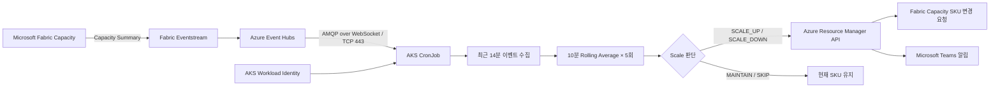
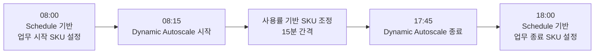
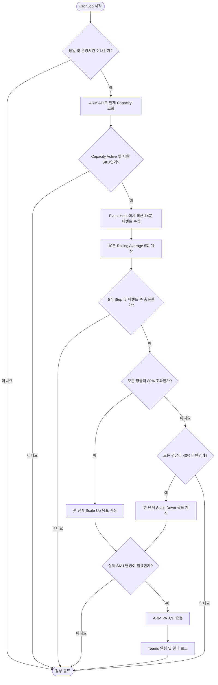
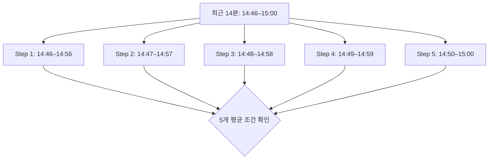
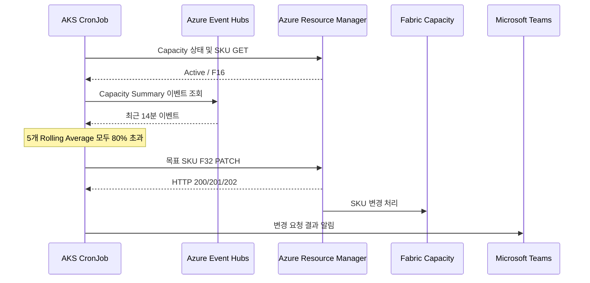

# Microsoft Fabric Capacity Dynamic Autoscale

Azure Event Hubs에서 Microsoft Fabric Capacity 사용률 데이터를 수집하고, AKS CronJob에서 Rolling Average(이동평균)를 계산하여 Fabric Capacity SKU를 자동으로 조정하는 구현 패턴입니다.

> **공개용 예제:** 아래 환경명, SKU 범위, 운영시간은 구현 사례를 바탕으로 한 예시 설정값입니다. 실제 환경에 맞게 변경해야 합니다. 이 문서에는 내부 GitLab URL, 실제 Capacity 이름 및 인증정보를 포함하지 않습니다.

## 1. 개요

Microsoft Fabric Capacity에 필요한 컴퓨팅 리소스는 업무시간과 워크로드 부하에 따라 달라집니다. Dynamic Autoscale은 Capacity 사용률을 주기적으로 평가하여 높은 사용률이 지속되면 Scale Up하고, 낮은 사용률이 지속되면 Scale Down합니다.

| 예시 환경 | Dynamic SKU 범위 | 변경 단위 |
|---|---|---|
| STG | F8 ↔ F16 | 인접 SKU 한 단계 |
| PRD | F16 ↔ F32 | 인접 SKU 한 단계 |

예를 들어 PRD 환경의 현재 SKU가 F16이고 Scale Up 조건이 충족되면 F32로 변경을 요청합니다. 실제 정책은 `DYNAMIC_SKU_POLICY`에 정의됩니다.

## 2. 전체 아키텍처



- **데이터 수집:** Fabric Capacity Summary 이벤트를 Eventstream을 통해 Event Hubs로 전달합니다.
- **인증:** AKS Workload Identity와 `DefaultAzureCredential`을 사용하며, 코드에 인증정보를 저장하지 않습니다.
- **제어:** CronJob이 Azure Resource Manager(ARM) API를 통해 Capacity 상태를 조회하고 필요한 경우 SKU 변경을 요청합니다.
- **검증:** 별도의 POC 스크립트에서 동일한 이벤트를 분석하지만 실제 SKU는 변경하지 않습니다.

## 3. 평일 운영 정책

Dynamic Autoscale은 **월요일부터 금요일까지 08:15 이상, 17:45 미만(KST)** 에 동작하도록 설정되어 있습니다.

기존 Schedule 기반 Capacity 제어 작업과의 충돌 가능성을 줄이기 위해 업무 시작 및 종료 시점에 각각 15분의 간격을 둡니다.



**주의:** 15분의 간격은 충돌 가능성을 줄이지만, 이전 Job의 실행이 지연되어 중복되는 상황까지 완전히 방지하지는 못합니다. 운영환경에서는 CronJob 중복 실행을 방지하고 다른 SKU 제어 작업과 실행시간을 조정해야 합니다.

### 평일 동작 예시

PRD 환경이 F16으로 시작한 경우, 높은 사용률이 연속적으로 유지되는 조건을 충족하면 F32로 Scale Up을 요청합니다.

이후 낮은 사용률이 연속적으로 유지되는 조건을 충족하면 F16으로 Scale Down을 요청합니다.

일시적인 사용률 급증이나 감소만으로는 SKU 변경이 발생하지 않습니다.

## 4. 주말 운영 정책

Dynamic Autoscale은 토요일과 일요일에는 동작하지 않습니다.

주말에 CronJob이 실행되더라도 애플리케이션에서 요일을 확인한 후 정상 종료하며, 사용률 데이터를 수집하거나 분석하지 않고 SKU도 변경하지 않습니다.

주말 Capacity 운영은 별도로 정의된 Schedule 기반 정책을 따릅니다.

## 5. Autoscale 처리 흐름



## 6. Autoscale 관리 대상 SKU

코드에는 다음 SKU 단계가 정의되어 있습니다.

```text
F2 → F4 → F8 → F16 → F32 → F64
```

Dynamic Autoscale 운영 범위는 환경별로 제한됩니다.

| 환경 | 최소 SKU | 최대 SKU | 일반적인 Scale Up / Down |
|---|---|---|---|
| STG | F8 | F16 | F8 ↔ F16 |
| PRD | F16 | F32 | F16 ↔ F32 |

현재 SKU가 운영 범위보다 **낮은 경우**, 고사용률 조건이 충족될 때만 한 단계 Scale Up합니다.

현재 SKU가 운영 범위보다 **높은 경우**, 저사용률 조건이 충족될 때만 한 단계 Scale Down합니다.

그 외에는 현재 SKU를 유지하며, 지원하지 않는 SKU는 변경하지 않습니다.

## 7. 최근 사용률 데이터 수집

Fabric Capacity Summary 이벤트의 `capacityUnitMs`와 `baseCapacityUnits` 필드를 사용하여 30초 이벤트별 사용률을 계산합니다.

```text
사용률(%) = capacityUnitMs / (baseCapacityUnits × 1000 × EventWindowSeconds) × 100
```

현재 설정은 `EventWindowSeconds = 30`입니다.

14분 데이터를 수집하는 이유는 **14분 평균을 계산하기 위해서가 아니라**, 1분 간격의 10분 평균 5개를 계산하는 데 필요한 최소 시간 범위를 확보하기 위해서입니다.

```text
조회 범위 = Window Size + ((Required Steps - 1) × Step Size)

          = 10분 + ((5 - 1) × 1분)

          = 14분
```

## 8. Rolling Average 분석

계산 기준 시각이 15:00이라고 가정하면 다음과 같이 평가합니다.

| Step | 10분 평균 구간(KST) | 평가 시각 |
|---|---|---|
| 1 | 14:46–14:56 | 14:56 |
| 2 | 14:47–14:57 | 14:57 |
| 3 | 14:48–14:58 | 14:58 |
| 4 | 14:49–14:59 | 14:59 |
| 5 | 14:50–15:00 | 15:00 |



각 Step은 해당 10분 구간에 포함된 이벤트 사용률의 산술평균입니다.

**1분 Step은 단일 CronJob 실행 내부의 계산 간격이며, CronJob 자체의 실행 주기가 아닙니다.**

> 이 구현에서 첫 번째 평가 시각과 마지막 평가 시각의 차이는 4분입니다. 이를 5회의 연속 평가로 처리하지만, Microsoft Fabric Activator 내부의 시간 처리 방식과 완전히 동일하다고 보장하지는 않습니다.

## 9. Scale Up 조건

**10분 평균 사용률 5개가 모두 80%를 초과하면** Scale Up을 선택합니다.

| Step | 평균 사용률 | 조건 |
|---|---:|---|
| 1 | 82% | 충족 |
| 2 | 84% | 충족 |
| 3 | 85% | 충족 |
| 4 | 87% | 충족 |
| 5 | 86% | 충족 |

**판단 결과: `SCALE_UP`**

현재 SKU와 정책에 따라 STG F8 → F16 또는 PRD F16 → F32 변경을 요청합니다.

## 10. Scale Down 조건

**10분 평균 사용률 5개가 모두 40% 미만이면** Scale Down을 선택합니다.

| Step | 평균 사용률 | 조건 |
|---|---:|---|
| 1 | 36% | 충족 |
| 2 | 34% | 충족 |
| 3 | 31% | 충족 |
| 4 | 29% | 충족 |
| 5 | 27% | 충족 |

**판단 결과: `SCALE_DOWN`**

현재 SKU와 정책에 따라 STG F16 → F8 또는 PRD F32 → F16 변경을 요청합니다.

## 11. Capacity를 변경하지 않는 경우

다음 예시에서는 Step 3의 평균 사용률이 80%를 초과하지 않으므로 연속 Scale Up 조건을 충족하지 못합니다.

| Step | 평균 사용률 |
|---|---:|
| 1 | 82% |
| 2 | 84% |
| 3 | 77% |
| 4 | 85% |
| 5 | 88% |

**판단 결과: `MAINTAIN` — 현재 SKU 유지**

다음 경우에도 SKU를 변경하지 않습니다.

- Capacity 상태가 `Active`가 아닌 경우
- 지원하지 않는 SKU인 경우
- Rolling Evaluation이 5개 미만인 경우
- 10분 Window의 이벤트 수가 예상치보다 부족한 경우(30초 간격 기준 20건)
- Scale Up / Down 조건을 충족하지 않거나 설정된 최대·최소 SKU에 이미 도달한 경우

이벤트 수 검증은 **기본적인 데이터 완전성 확인 방법**입니다. 이벤트가 20건 이상 수집되더라도 모든 예상 시간 구간에 균등하게 분포되어 있다고 보장할 수는 없습니다.

## 12. 실제 Capacity SKU 변경

Scale Up 또는 Scale Down이 필요한 경우 현재 SKU를 기준으로 목표 SKU를 계산하고 ARM API에 PATCH 요청을 전송합니다.



**주의:** ARM API의 `200`, `201`, `202` 응답은 요청 성공 또는 접수를 의미합니다. 특히 `202 Accepted`는 실제 SKU 변경 완료를 보장하지 않습니다.

변경 완료 여부는 Capacity 상태와 SKU를 다시 조회하여 별도로 검증해야 합니다.

## 13. Autoscale 실행 주기

Dynamic Autoscale CronJob은 **15분 간격**으로 실행하도록 설정되어 있습니다.

```text
14:45          15:00          15:15          15:30
  |              |              |              |
  v              v              v              v
Autoscale      Autoscale      Autoscale      Autoscale
평가           평가           평가           평가
```

Fabric 사용률 이벤트는 CronJob 실행과 관계없이 Event Hubs로 계속 전달됩니다.

실제 CronJob 실행 일정은 Kubernetes Helm values 또는 CronJob 매니페스트의 `spec.schedule`을 통해 관리합니다.

**예시 파일: `cronjob.yaml`**

```yaml
schedule: "*/15 * * * 1-5"
```

> 위 설정은 평일 15분 간격 실행 예시입니다. 애플리케이션 내부의 08:15~17:45 운영시간 검사와 함께 사용해야 합니다. CronJob의 시간대는 `spec.timeZone: "Asia/Seoul"`처럼 명시적으로 설정하고, Kubernetes 스케줄러 설정 및 `concurrencyPolicy`도 확인해야 합니다.

## 14. Microsoft Teams 알림

실제 SKU 변경이 요청되면 애플리케이션이 Teams 알림을 전송합니다. 변경 요청 실패 시에도 알림 전송을 시도합니다.

`TEAMS_WEBHOOK_URL`이 설정되지 않은 경우 알림은 생략됩니다.

```text
Fabric Capacity Dynamic Autoscale Notification

Environment : PRD
Capacity    : example-fabric-capacity
Event       : Dynamic-Autoscale
Message     : SCALE_UP: F16 -> F32 | 10-min AVG=85.42% | 5 consecutive evaluations met
```

이 알림은 SKU 변경 **요청 결과**를 전달하는 것으로, 실제 SKU 변경 완료 검증을 대신하지 않습니다.

## 15. 배포 환경변수

| 환경변수 | 용도 | 공개용 예시 |
|---|---|---|
| `ENV` | 환경별 SKU 정책 선택 | `stg` 또는 `prd` |
| `subscriptionId` | Azure Subscription ID | `<subscription-id>` |
| `resourceGroup` | Fabric Capacity 리소스 그룹 | `<resource-group>` |
| `capacityName` | Fabric Capacity 이름 | `example-fabric-capacity` |
| `Fabric-Event-Hub-namespace-endpoint` | Event Hubs FQDN | `example.servicebus.windows.net` |
| `Fabric-Event-Hub-name` | Event Hub 이름 | `fabric-capacity-events` |
| `Fabric-Event-Hub-Consumer-group` | Consumer Group | `$Default` |
| `TEAMS_WEBHOOK_URL` | Teams 알림 URL(선택) | Secret으로 주입 |

필요한 Python 패키지는 `azure-eventhub`, `azure-identity`, `requests`입니다.

AKS ServiceAccount에 Workload Identity를 구성하고, Event Hubs 데이터 수신 권한과 Fabric Capacity 변경 권한을 각각 부여해야 합니다.

## 16. 운영 검증

배포 후 다음 항목을 확인합니다.

1. **CronJob:** `kubectl get cronjob -n <namespace>`로 실행 일정 및 배포 상태를 확인합니다.
2. **Job 실행:** `kubectl get jobs -n <namespace>`로 최근 실행 내역과 성공 여부를 확인합니다.
3. **실행 로그:** `kubectl logs -n <namespace> job/<job-name>`으로 Rolling Average, Action, 목표 SKU를 확인합니다.
4. **ARM:** Azure Portal의 Fabric Capacity 리소스에서 현재 상태와 SKU를 확인합니다.
5. **Teams:** SKU 변경 요청 발생 시 알림 수신 여부를 확인합니다.
6. **안전 조건:** 운영시간 외, 주말, 데이터 부족, Capacity 비활성 상태에서 SKU가 변경되지 않는지 확인합니다.

## 17. 요약

| 항목 | 정책 |
|---|---|
| 평일 운영 | 월~금 08:15 이상 ~ 17:45 미만(KST) |
| 주말 운영 | Dynamic Autoscale 비활성화 |
| CronJob 실행 주기 | 15분 간격 |
| 이벤트 조회 범위 | 최근 14분 |
| 사용률 계산 | 30초 Capacity Summary 이벤트 |
| Rolling Average | 10분 Window, 1분 Step, 5회 평가 |
| Scale Up | 5개 평균 모두 80% 초과 |
| Scale Down | 5개 평균 모두 40% 미만 |
| 조건 미충족 | 현재 SKU 유지 |
| 데이터 부족 또는 유효하지 않음 | SKU 변경하지 않음 |
| STG SKU | F8 ↔ F16 |
| PRD SKU | F16 ↔ F32 |
| 변경 단위 | 인접 SKU 한 단계 |
| 변경 API | Azure Resource Manager |
| 알림 | Microsoft Teams |
| 변경 대응 시점 | 다음 CronJob 평가 시점(최대 15분의 스케줄 대기 + 수집·처리 지연) |

---

**참고:** 본 문서는 예시 정책을 포함한 Reference Architecture입니다. 실제 운영환경에 적용하기 전에 Fabric Capacity SKU, 이벤트 수집 지연, Azure API 권한, 중복 실행 방지, Schedule 기반 제어 작업과의 충돌 여부를 검증해야 합니다.