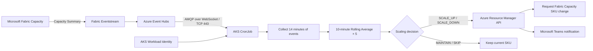
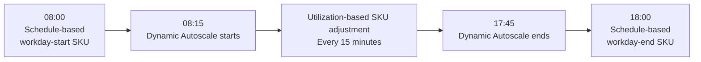
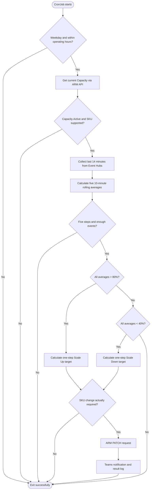
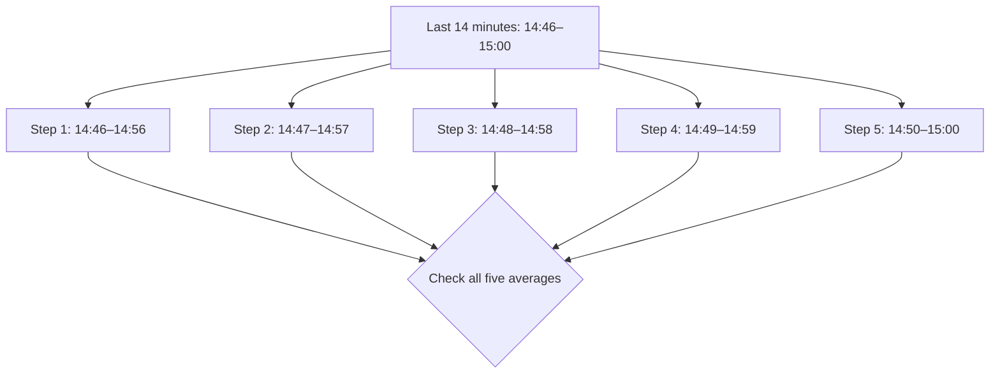
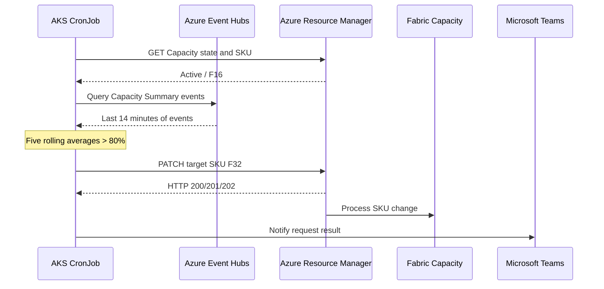

# Microsoft Fabric Capacity Dynamic Autoscale

An implementation pattern that collects Microsoft Fabric Capacity utilization data from Azure Event Hubs, calculates rolling averages in an AKS CronJob, and automatically adjusts Fabric Capacity SKUs.

> **Public example:** The environment names, SKU ranges, and operating hours below are example configuration values from an implementation. Adjust them for your environment. This document does not contain internal GitLab URLs, actual Capacity names, or credentials.

## 1. Overview

The compute resources required by Fabric Capacity vary with business hours and workload demand. Dynamic Autoscale periodically evaluates Capacity utilization, scales up when high utilization persists, and scales down when low utilization persists.

| Example environment | Dynamic SKU range | Change per operation |
|---|---|---|
| STG | F8 ↔ F16 | One adjacent SKU level |
| PRD | F16 ↔ F32 | One adjacent SKU level |

For example, if the current PRD SKU is F16 and the Scale Up condition is met, the application requests a change to F32. The actual policy is defined in `DYNAMIC_SKU_POLICY`.

## 2. Overall Architecture



- **Data collection:** Fabric Capacity Summary events are forwarded to Event Hubs through Eventstream.
- **Authentication:** AKS Workload Identity and `DefaultAzureCredential` are used. No credentials are stored in the code.
- **Control:** The CronJob retrieves Capacity state through the Azure Resource Manager (ARM) API and requests an SKU change when needed.
- **Validation:** A separate POC script analyzes the same events but does not modify the SKU.

## 3. Weekday Operations

Dynamic Autoscale is configured to run **Monday through Friday, from 08:15 inclusive to 17:45 exclusive (KST)**. A 15-minute buffer is placed around the start and end of the business day to reduce conflicts with existing schedule-based Capacity control jobs.



**Important:** The 15-minute buffer reduces the chance of conflicts but does not guarantee that a delayed previous Job cannot overlap. In production, prevent overlapping CronJob executions and coordinate with other SKU control jobs.

### Weekday Example

If PRD starts at F16, an execution that satisfies the sustained high-utilization condition requests a scale-up to F32. If the sustained low-utilization condition is met later, the application requests a scale-down to F16. A brief utilization spike or dip alone does not trigger a change.

## 4. Weekend Operations

Dynamic Autoscale does not operate on Saturdays or Sundays. Even if the CronJob runs, the application checks the day of the week and exits successfully without collecting or analyzing utilization data or modifying the SKU. Weekend Capacity operations follow a separately defined schedule-based policy.

## 5. Autoscale Processing Flow



## 6. SKUs Managed by Autoscale

The following SKU levels are defined in the code:

```text
F2 → F4 → F8 → F16 → F32 → F64
```

The dynamic operating range is restricted by environment.

| Environment | Minimum | Maximum | Typical Scale Up / Down |
|---|---|---|---|
| STG | F8 | F16 | F8 ↔ F16 |
| PRD | F16 | F32 | F16 ↔ F32 |

If the current SKU is **below** the operating range, it is increased by one level only when the high-utilization condition is met. If the current SKU is **above** the operating range, it is decreased by one level only when the low-utilization condition is met. Otherwise, the current SKU is maintained. Unsupported SKUs are not modified.

## 7. Recent Utilization Collection

Utilization is calculated for each 30-second event using the `capacityUnitMs` and `baseCapacityUnits` fields of Fabric Capacity Summary events.

```text
Utilization (%) = capacityUnitMs / (baseCapacityUnits × 1000 × EventWindowSeconds) × 100
```

The current configuration uses `EventWindowSeconds = 30`. The reason for collecting 14 minutes of data is **not to calculate a 14-minute average**, but to obtain the minimum time span required to calculate five 10-minute averages at one-minute intervals.

```text
Lookback = Window Size + ((Required Steps - 1) × Step Size)
         = 10 minutes + ((5 - 1) × 1 minute)
         = 14 minutes
```

## 8. Rolling Average Analysis

Assuming the evaluation reference time is 15:00, the windows are evaluated as follows.

| Step | 10-minute window (KST) | Evaluation time |
|---|---|---|
| 1 | 14:46–14:56 | 14:56 |
| 2 | 14:47–14:57 | 14:57 |
| 3 | 14:48–14:58 | 14:58 |
| 4 | 14:49–14:59 | 14:59 |
| 5 | 14:50–15:00 | 15:00 |



Each step is the arithmetic mean of event utilization values collected within that window. **The one-minute step is a calculation interval within a single CronJob execution, not the CronJob execution frequency.**

> In this implementation, the time between the first and last of the five evaluation timestamps is four minutes. These are treated as five consecutive evaluations; exact equivalence to Microsoft Fabric Activator's internal time semantics is not guaranteed.

## 9. Scale Up Criteria

Scale Up is selected when **all five 10-minute average utilization values are strictly greater than 80%**.

| Step | Average utilization | Condition |
|---|---:|---|
| 1 | 82% | Met |
| 2 | 84% | Met |
| 3 | 85% | Met |
| 4 | 87% | Met |
| 5 | 86% | Met |

**Result: `SCALE_UP`** — STG F8 → F16 or PRD F16 → F32 (depending on the current SKU and policy).

## 10. Scale Down Criteria

Scale Down is selected when **all five 10-minute average utilization values are strictly below 40%**.

| Step | Average utilization | Condition |
|---|---:|---|
| 1 | 36% | Met |
| 2 | 34% | Met |
| 3 | 31% | Met |
| 4 | 29% | Met |
| 5 | 27% | Met |

**Result: `SCALE_DOWN`** — STG F16 → F8 or PRD F32 → F16 (depending on the current SKU and policy).

## 11. When Capacity Is Not Modified

In the following example, Step 3 does not exceed 80%, so the consecutive Scale Up condition is not satisfied.

| Step | Average utilization |
|---|---:|
| 1 | 82% |
| 2 | 84% |
| 3 | 77% |
| 4 | 85% |
| 5 | 88% |

**Result: `MAINTAIN`** — Keep the current SKU.

No change is made in the following cases either:

- Capacity state is not `Active`.
- The SKU is unsupported.
- Fewer than five rolling evaluations are available.
- A 10-minute window contains fewer than the expected number of events (20 at 30-second intervals).
- Scaling conditions are not met, or the configured upper/lower boundary has already been reached.

The event count check is a **basic data-completeness check**. Even with 20 or more events, it does not guarantee that events are evenly distributed across all expected time intervals.

## 12. Actual Capacity Modification

When Scale Up or Scale Down is required, the application calculates the target SKU based on the current SKU and sends a PATCH request to the ARM API.



**Caution:** ARM API responses `200`, `201`, and `202` indicate request success or acceptance. In particular, `202 Accepted` does not guarantee that the SKU change is complete. Verify completion separately by retrieving the Capacity state and SKU again.

## 13. Autoscale Execution Frequency

The Dynamic Autoscale CronJob is configured to run **every 15 minutes**.

```text
14:45          15:00          15:15          15:30
  |              |              |              |
  v              v              v              v
Autoscale      Autoscale      Autoscale      Autoscale
Evaluation     Evaluation     Evaluation     Evaluation
```

Fabric utilization events continue to flow into Event Hubs independently of CronJob execution. The actual CronJob schedule is managed through Kubernetes Helm values or `spec.schedule` in the CronJob manifest.

```yaml
schedule: "*/15 * * * 1-5"
```

> This schedule is an **example** of a 15-minute weekday cadence. It must be used together with the application's 08:15–17:45 time check, and the CronJob timezone should be explicitly specified, for example `spec.timeZone: "Asia/Seoul"`. Also verify Kubernetes scheduler configuration and the CronJob `concurrencyPolicy`.

## 14. Teams Notifications

When an actual SKU change is requested, the application sends a Teams notification. It also attempts to notify on failed requests. If `TEAMS_WEBHOOK_URL` is not configured, notifications are skipped.

```text
Fabric Capacity Dynamic Autoscale Notification
Environment : PRD
Capacity    : example-fabric-capacity
Event       : Dynamic-Autoscale
Message     : SCALE_UP: F16 -> F32 | 10-min AVG=85.42% | 5 consecutive evaluations met
```

The notification reports the change request result; it does not replace verification of completed SKU modification.

## 15. Deployment Environment Variables

| Environment variable | Purpose | Public example |
|---|---|---|
| `ENV` | Select environment-specific SKU policy | `stg` or `prd` |
| `subscriptionId` | Azure Subscription ID | `<subscription-id>` |
| `resourceGroup` | Fabric Capacity resource group | `<resource-group>` |
| `capacityName` | Fabric Capacity name | `example-fabric-capacity` |
| `Fabric-Event-Hub-namespace-endpoint` | Event Hubs FQDN | `example.servicebus.windows.net` |
| `Fabric-Event-Hub-name` | Event Hub name | `fabric-capacity-events` |
| `Fabric-Event-Hub-Consumer-group` | Consumer group | `$Default` |
| `TEAMS_WEBHOOK_URL` | Teams notification URL (optional) | Inject as a secret |

Required Python packages are `azure-eventhub`, `azure-identity`, and `requests`. Configure the AKS ServiceAccount for Workload Identity and grant Event Hubs data-receive and Fabric Capacity modification permissions separately.

## 16. Operational Validation

After deployment, verify the following:

1. **CronJob:** Check the schedule and deployment status using `kubectl get cronjob -n <namespace>`.
2. **Job execution:** Check recent executions and success status using `kubectl get jobs -n <namespace>`.
3. **Logs:** Check rolling averages, Action, and target SKU using `kubectl logs -n <namespace> job/<job-name>`.
4. **ARM:** Check the current state and SKU in the Fabric Capacity resource in Azure Portal.
5. **Teams:** Confirm notification delivery when an SKU change is requested.
6. **Safety conditions:** Confirm that no SKU changes occur outside operating hours, on weekends, with insufficient data, or when Capacity is not Active.

## 17. Summary

| Item | Policy |
|---|---|
| Weekday operation | Monday–Friday, 08:15 inclusive to 17:45 exclusive (KST) |
| Weekend operation | Dynamic Autoscale disabled |
| CronJob execution frequency | Every 15 minutes |
| Event lookback | Last 14 minutes |
| Utilization calculation | 30-second Capacity Summary events |
| Rolling Average | 10-minute window, 1-minute step, 5 evaluations |
| Scale Up | All five averages > 80% |
| Scale Down | All five averages < 40% |
| Conditions not met | Maintain current SKU |
| Insufficient/invalid data | Do not modify SKU |
| STG SKU | F8 ↔ F16 |
| PRD SKU | F16 ↔ F32 |
| Change granularity | One adjacent SKU level |
| Change API | Azure Resource Manager |
| Notifications | Microsoft Teams |
| Response timing | Next CronJob evaluation (up to 15 minutes of scheduling wait + collection/processing delays) |

---

**Note:** This is a reference architecture with example policies. Before production use, validate Fabric Capacity SKUs, event collection latency, Azure API permissions, overlapping execution prevention, and conflicts with schedule-based control jobs.
