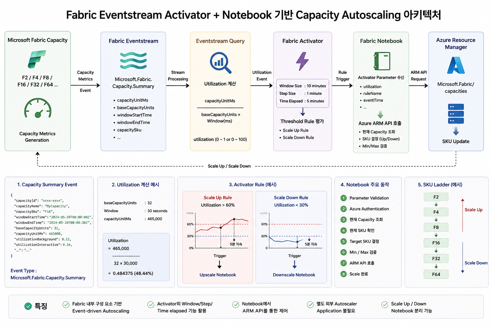
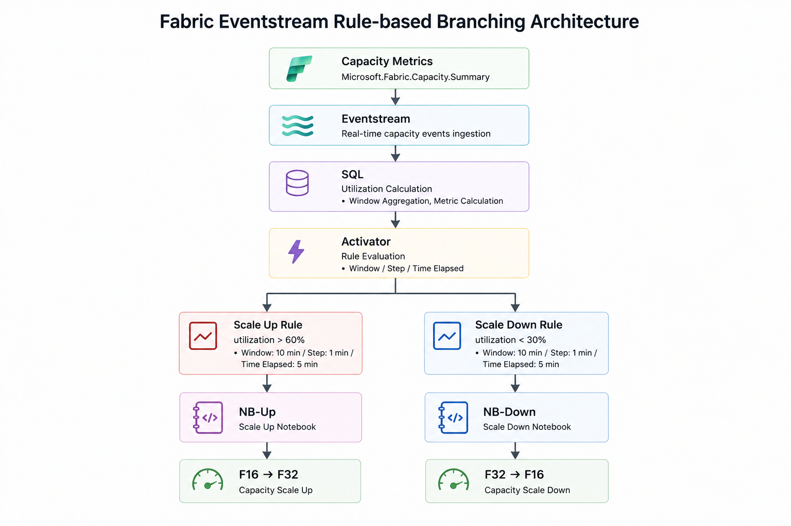

# Fabric Eventstream Activator + Notebook 기반 Capacity Autoscaling

Microsoft Fabric Capacity에서 발생하는 실시간 Capacity Summary 이벤트를 Fabric Eventstream으로 수집하고,  
Stream Query에서 계산된 Capacity Utilization을 Fabric Activator가 지속적으로 평가하여  
조건에 따라 Scale Up / Scale Down Notebook을 실행하고 Azure ARM API를 통해 Fabric Capacity SKU를 자동 조정하는 Autoscaling 구조입니다.

---

# 1. Overview

본 방식은 Microsoft Fabric의 **Real-Time Intelligence** 기능을 활용하여 Capacity 사용량을 실시간으로 감지하고 Autoscaling을 수행하기 위한 POC입니다.

Fabric Capacity에서 발생하는 다음 이벤트를 Metric Source로 사용합니다.

```text
Microsoft.Fabric.Capacity.Summary
```

전체 흐름은 다음과 같습니다.

```text
Fabric Capacity
        ↓
Capacity Summary Event
        ↓
Fabric Eventstream
        ↓
Stream SQL
        ↓
Utilization 계산
        ↓
Fabric Activator
        ↓
Rule Evaluation
        ↓
        ├───────────────┐
        │               │
        ▼               ▼
  Scale Up Rule   Scale Down Rule
        │               │
        ▼               ▼
      NB-Up           NB-Down
        │               │
        ▼               ▼
    F16 → F32       F32 → F16
```

Activator에서 설정된 Threshold 조건이 일정 시간 이상 지속되면 해당 Notebook을 호출하고,  
Notebook에서는 현재 Fabric Capacity 상태를 조회한 뒤 Azure ARM API를 통해 SKU를 변경합니다.

### 주요 특징

- Fabric Capacity Summary Event 기반 실시간 Metric 수집
- Fabric Eventstream을 통한 Event Processing
- Stream SQL 기반 Utilization 계산
- Fabric Activator 기반 Rule Evaluation
- Scale Up / Scale Down Rule 분리
- Window / Step / Time Elapsed 기반 지속 조건 판단
- Activator → Notebook Parameter 전달
- Scale Up / Scale Down Notebook 독립 구성
- Notebook → Azure ARM API 호출
- Fabric 내부 중심의 Event-driven Autoscaling
- 별도의 상시 실행 Autoscaler Application 불필요

---

# 2. Architecture

## 2.1 End-to-End Architecture

전체 Autoscaling Architecture는 다음과 같습니다.



전체 처리 흐름은 다음과 같습니다.

```text
Microsoft Fabric Capacity
        ↓
Capacity Metrics Event
        ↓
Microsoft.Fabric.Capacity.Summary
        ↓
Fabric Eventstream
        ↓
Stream Query
        ↓
Utilization 계산
        ↓
Fabric Activator
        ↓
Threshold / Duration Rule
        ↓
Fabric Notebook
        ↓
Azure ARM API
        ↓
Microsoft.Fabric/capacities
        ↓
Fabric Capacity SKU Update
```

본 방식에서는 Capacity Metric 수집부터 Threshold 평가까지 대부분의 Control Flow를 Fabric 내부에서 처리합니다.

---

## 2.2 Rule-based Branching Architecture

Activator에서는 Eventstream으로부터 전달된 Utilization 값을 기준으로  
Scale Up과 Scale Down을 각각 독립적인 Rule로 평가합니다.



구성은 다음과 같습니다.

```text
Capacity Metrics
        │
        ▼
Eventstream
        │
        ▼
SQL
(Utilization 계산)
        │
        ▼
Activator
        │
        ├────────────────────┐
        │                    │
        ▼                    ▼
 Scale Up Rule        Scale Down Rule
 Utilization > 60%    Utilization < 30%
        │                    │
        ▼                    ▼
      NB-Up                NB-Down
        │                    │
        ▼                    ▼
    F16 → F32            F32 → F16
```

POC에서는 다음 Rule을 기준으로 검증하였습니다.

| Rule | Condition | Window | Step | Time Elapsed | Action |
|---|---|---:|---:|---:|---|
| Scale Up | Utilization > 60% | 10 min | 1 min | 5 min | NB-Up |
| Scale Down | Utilization < 30% | 10 min | 1 min | 5 min | NB-Down |

즉,

> **최근 10분간의 Utilization을 1분마다 평가하고, Scale Up 또는 Scale Down 조건이 5분 동안 지속될 경우 해당 Notebook을 실행합니다.**

---

# 3. Fabric Capacity Eventstream 구성

## 3.1 Fabric Capacity Events 연결

Fabric Workspace에서 Fabric Capacity 관련 이벤트를 Source로 사용하는 Eventstream을 생성합니다.

Autoscaling에 사용되는 주요 Event Type은 다음과 같습니다.

```text
Microsoft.Fabric.Capacity.Summary
```

Capacity Summary Event에는 일정 Window 동안의 Fabric Capacity 사용량과 상태 정보가 포함됩니다.

대표적인 Field는 다음과 같습니다.

| Field | Description |
|---|---|
| `capacityId` | Fabric Capacity ID |
| `capacityName` | Capacity 이름 |
| `capacitySku` | 현재 Capacity SKU |
| `capacityRegion` | Capacity Region |
| `windowStartTime` | 측정 Window 시작 시간 |
| `windowEndTime` | 측정 Window 종료 시간 |
| `baseCapacityUnits` | 현재 Capacity의 기본 CU |
| `capacityUnitMs` | Window 내 사용된 Capacity Unit Milliseconds |
| `utilizationBackground` | Background Workload 사용량 |
| `utilizationInteractive` | Interactive Workload 사용량 |
| `interactiveDelayThresholdPercentage` | Interactive Delay 관련 지표 |
| `interactiveRejectionThresholdPercentage` | Interactive Rejection 관련 지표 |
| `backgroundRejectionThresholdPercentage` | Background Rejection 관련 지표 |
| `overageTotalCapacityUnitMs` | Overage 사용량 |
| `overageBillingProtectionActive` | Overage Billing Protection 상태 |

Eventstream 구성을 완료한 후 반드시 **Publish**하여 Event가 정상적으로 수집되는지 확인합니다.

---

# 4. Utilization 계산

## 4.1 기본 계산 방식

Capacity Summary에서 제공되는 다음 값을 이용합니다.

```text
capacityUnitMs
baseCapacityUnits
windowStartTime
windowEndTime
```

Capacity Budget은 다음과 같이 계산할 수 있습니다.

```text
Capacity Budget
    =
    baseCapacityUnits
    × Window Duration(ms)
```

30초 Window라면:

```text
Capacity Budget
    =
    baseCapacityUnits
    × 30,000
```

Utilization은 다음과 같습니다.

```text
Utilization
    =
    capacityUnitMs
    /
    (baseCapacityUnits × 30,000)
```

백분율로 표현하면:

```text
Utilization (%)
    =
    capacityUnitMs
    /
    (baseCapacityUnits × 30,000)
    × 100
```

---

## 4.2 Stream SQL

Eventstream에서 Capacity Summary Event를 처리하여 Activator에 전달할 `utilization` 값을 생성합니다.

개념적인 계산식은 다음과 같습니다.

```sql
capacityUnitMs
/
(
    baseCapacityUnits
    *
    DATEDIFF(
        millisecond,
        windowStartTime,
        windowEndTime
    )
)
```

예를 들어:

```text
baseCapacityUnits : 32
Window            : 30 seconds
capacityUnitMs    : 465,000
```

이면:

```text
465,000
────────────────
32 × 30,000

= 0.484375
```

따라서:

```text
utilization = 0.484375
```

백분율로는:

```text
48.44%
```

입니다.

> Activator에서 `0.6 = 60%` 방식으로 사용할지, Stream SQL에서 미리 `× 100`하여 `60 = 60%` 방식으로 사용할지는 전체 구현에서 일관되게 유지해야 합니다.

---

# 5. Fabric Activator

## 5.1 Activator 역할

Fabric Activator는 Eventstream에서 전달되는 Utilization을 지속적으로 평가하고,  
설정된 조건이 만족될 경우 연결된 Notebook Action을 실행합니다.

단일 Event의 순간적인 값만 기준으로 하지 않고 일정 Window 동안의 Metric을 평가할 수 있습니다.

POC 구성:

```text
Window Size  : 10 minutes
Step Size    : 1 minute
Time Elapsed : 5 minutes
```

각 항목의 의미는 다음과 같습니다.

| 설정 | 설명 |
|---|---|
| Window Size | 최근 10분 데이터를 기준으로 평가 |
| Step Size | 1분마다 조건을 다시 평가 |
| Time Elapsed | 조건이 5분 동안 지속될 경우 Trigger |

즉:

```text
최근 10분 데이터
       ↓
1분마다 평가
       ↓
Threshold 조건 확인
       ↓
5분 지속 여부 확인
       ↓
Notebook Trigger
```

---

# 6. Autoscaling Rules

Scale Up과 Scale Down은 각각 독립적인 Activator Rule로 구성합니다.

## 6.1 Scale Up Rule

POC 기준:

```text
Utilization > 60%
```

처리 흐름:

```text
Utilization
     ↓
> 60%
     ↓
조건 지속
     ↓
5분 경과
     ↓
Scale Up Rule Trigger
     ↓
NB-Up
     ↓
현재 SKU 조회
     ↓
F16 → F32
```

---

## 6.2 Scale Down Rule

POC 기준:

```text
Utilization < 30%
```

처리 흐름:

```text
Utilization
     ↓
< 30%
     ↓
조건 지속
     ↓
5분 경과
     ↓
Scale Down Rule Trigger
     ↓
NB-Down
     ↓
현재 SKU 조회
     ↓
F32 → F16
```

---

## 6.3 Hysteresis

Scale Up Threshold와 Scale Down Threshold 사이에 충분한 간격을 두어  
Threshold 경계에서 Capacity SKU가 반복적으로 변경되는 현상을 방지합니다.

```text
Utilization

100% ┤
     │
 60% ┼──────────── Scale Up
     │
     │
     │    Maintain
     │
     │
 30% ┼──────────── Scale Down
     │
  0% ┤
```

POC에서는:

```text
Scale Up   : > 60%
Maintain   : 30% ~ 60%
Scale Down : < 30%
```

구조를 사용합니다.

---

# 7. Activator → Notebook

Activator Rule이 Trigger되면 연결된 Fabric Notebook을 Action으로 실행합니다.

POC에서는 Scale Up과 Scale Down을 각각 별도의 Notebook으로 구성합니다.

```text
Scale Up Rule
     ↓
NB-Up

Scale Down Rule
     ↓
NB-Down
```

Activator는 Notebook Parameter로 Utilization 값을 전달합니다.

예:

```text
Parameter Name  : utilization
Parameter Value : 0.484638237838223
```

POC 과정에서는 해당 값이 Python에서 `str` Type으로 전달되는 것을 확인하였습니다.

```text
Python Type      : str
Python Full Type : <class 'str'>
```

따라서 Notebook에서는 명시적인 Type Conversion을 수행합니다.

```python
utilization = float(
    str(utilization).strip()
)
```

처리 과정:

```text
Activator
   ↓
"0.484638237838223 "
   ↓
strip()
   ↓
"0.484638237838223"
   ↓
float()
   ↓
0.484638237838223
```

---

# 8. Fabric Notebook

Notebook은 Activator로부터 호출된 이후 실제 Capacity Control을 수행합니다.

Scale Up / Scale Down Notebook의 기본 Flow는 다음과 같습니다.

```text
Activator Trigger
        ↓
Notebook Start
        ↓
Parameter Validation
        ↓
Azure Authentication
        ↓
현재 Capacity 조회
        ↓
현재 SKU 확인
        ↓
Scale 가능 여부 확인
        ↓
Target SKU 결정
        ↓
Azure ARM API 호출
        ↓
SKU 변경
        ↓
변경 결과 확인
```

Notebook은 별도로 구성할 수 있습니다.

```text
NB-Up
└─ Fabric Capacity Scale Up

NB-Down
└─ Fabric Capacity Scale Down
```

예:

```text
NB-Up
F16 → F32

NB-Down
F32 → F16
```

---

# 9. Azure Authentication

Fabric Notebook에서 Capacity SKU를 변경하려면 Azure Resource Manager Access Token이 필요합니다.

개념적인 인증 흐름:

```text
Fabric Notebook
        ↓
Microsoft Entra ID
        ↓
Azure Management Token
        ↓
Azure Resource Manager
        ↓
Microsoft.Fabric/capacities
```

실제 운영환경에서는 Credential을 Notebook Source Code에 직접 저장하지 않고  
Managed Identity, Secret Store 또는 별도의 Credential Management 방식을 사용하는 것을 권장합니다.

---

# 10. Azure ARM API

Fabric Capacity Resource Provider:

```text
Microsoft.Fabric/capacities
```

Resource URI 구조:

```text
/subscriptions/<subscription-id>
/resourceGroups/<resource-group>
/providers/Microsoft.Fabric
/capacities/<capacity-name>
```

현재 Capacity 정보를 조회하여 현재 SKU를 확인한 뒤 Target SKU를 결정합니다.

Scale Up 예:

```text
Current SKU : F16
Utilization : 72%
Threshold   : 60%

        ↓

Scale Up

        ↓

Target SKU : F32
```

Scale Down 예:

```text
Current SKU : F32
Utilization : 18%
Threshold   : 30%

        ↓

Scale Down

        ↓

Target SKU : F16
```

이후 Azure ARM API의 SKU Update 요청을 통해 Capacity를 변경합니다.

---

# 11. SKU Policy

POC에서는 다음 Scale Range를 기준으로 검증하였습니다.

```text
F16
 │
 │ Scale Up
 ▼
F32
```

```text
F32
 │
 │ Scale Down
 ▼
F16
```

실제 운영에서는 필요에 따라 다음과 같은 SKU Ladder를 구성할 수 있습니다.

```text
F2
 ↓
F4
 ↓
F8
 ↓
F16
 ↓
F32
 ↓
F64
```

최소 및 최대 SKU를 명시적으로 제한하는 것을 권장합니다.

예:

```text
SKU_MIN = F16
SKU_MAX = F64
```

이를 통해 Autoscaler가 허용된 Capacity 범위를 벗어나지 않도록 제어할 수 있습니다.

---

# 12. End-to-End Scale Flow

## 12.1 Scale Up

```text
Capacity Summary
        ↓
Eventstream
        ↓
Stream SQL
        ↓
Utilization
        ↓
Activator
        ↓
Utilization > 60%
        ↓
Window / Duration 조건 충족
        ↓
NB-Up
        ↓
현재 SKU 확인
        ↓
F16
        ↓
ARM PATCH
        ↓
F32
```

---

## 12.2 Scale Down

```text
Capacity Summary
        ↓
Eventstream
        ↓
Stream SQL
        ↓
Utilization
        ↓
Activator
        ↓
Utilization < 30%
        ↓
Window / Duration 조건 충족
        ↓
NB-Down
        ↓
현재 SKU 확인
        ↓
F32
        ↓
ARM PATCH
        ↓
F16
```

---

# 13. POC Configuration

POC에서 검증한 설정은 다음과 같습니다.

| Item | Value |
|---|---|
| Event Type | `Microsoft.Fabric.Capacity.Summary` |
| Capacity Event Window | 30 seconds |
| Activator Window Size | 10 minutes |
| Activator Step Size | 1 minute |
| Activator Time Elapsed | 5 minutes |
| Scale Up Threshold | > 60% |
| Scale Down Threshold | < 30% |
| Scale Up | F16 → F32 |
| Scale Down | F32 → F16 |
| Scale Control | Azure ARM API |
| Execution | Fabric Notebook |

> Threshold 및 SKU Range는 POC 검증을 위한 예시이며 Production 적용 시 실제 Capacity Workload 및 운영 정책을 기반으로 재설계해야 합니다.

---

# 14. Advantages

본 방식의 가장 큰 특징은 Autoscaling Workflow 대부분을 Fabric 내부에서 구성할 수 있다는 점입니다.

```text
Fabric Capacity
      ↓
Eventstream
      ↓
Activator
      ↓
Notebook
```

### 장점

- 별도의 Kubernetes Consumer 불필요
- 외부 Event Consumer Application 불필요
- Fabric Real-Time Intelligence 기능 활용
- Activator 기반 선언적 Rule 구성
- Window / Step / Time Elapsed 기능 제공
- Scale Up / Scale Down Rule 독립 관리 가능
- Python에서 별도의 지속 상태관리 Logic 구현 불필요
- Fabric 내부에서 End-to-End Autoscaling POC 구현 가능

---

# 15. Considerations

## 15.1 Notebook Session Initialization

Activator가 Trigger되더라도 Notebook은 즉시 Python Code를 실행하는 것이 아니라  
먼저 Notebook Session을 준비해야 할 수 있습니다.

```text
Activator Trigger
        ↓
Notebook 호출
        ↓
Session 준비
        ↓
Notebook 실행
        ↓
ARM API 호출
```

따라서 Autoscaling 반응시간은 Notebook Session 초기화 상태의 영향을 받을 수 있습니다.

---

## 15.2 Fabric Resource Dependency

Autoscaling Control Logic 자체가 Fabric Notebook에서 실행됩니다.

따라서 Fabric Capacity 부하가 높은 상황에서도 Autoscaling Workflow가 Fabric 실행환경에 의존하게 됩니다.

```text
Fabric Capacity 부하 증가
        ↓
Activator Trigger
        ↓
Fabric Notebook 실행 필요
        ↓
Fabric Resource 사용
```

---

## 15.3 Notebook Resource Usage

Capacity를 제어하기 위한 Notebook 실행 자체도 Fabric Resource를 사용합니다.

이러한 이유로 후속 POC에서는 Control Plane을 Fabric 외부로 분리하는 다음 방식도 검증하였습니다.

```text
Fabric Eventstream
        ↓
Custom Endpoint
        ↓
AKS CronJob
        ↓
Azure ARM API
```

---

# 16. Activator + Notebook vs Custom Endpoint + AKS

두 방식의 가장 큰 차이는 **Capacity Metric Source가 아니라 Autoscaling Control Logic을 어디에서 실행하는가**입니다.

| 구분 | Activator + Notebook | Custom Endpoint + AKS CronJob |
|---|---|---|
| Metrics Source | Fabric Capacity Event | Fabric Capacity Event |
| Event 수집 | Fabric Eventstream | Fabric Eventstream |
| Utilization 계산 | Stream SQL | AKS Python |
| Threshold 판단 | Fabric Activator | Python Autoscaler |
| Trigger | Activator Rule | Kubernetes CronJob |
| Scale 실행 | Fabric Notebook | AKS Python |
| ARM API 호출 | Notebook | AKS |
| Notebook Session | 필요 | 불필요 |
| Custom Endpoint | 불필요 | 필요 |
| AKS → Eventstream 통신 | 불필요 | 필요 |
| Network Firewall | 상대적으로 단순 | TCP 443 Outbound 필요 |
| 상태 평가 | Activator | Application Logic |
| Control Plane | Fabric | AKS |
| 실행 방식 | Event-driven | Scheduled One-Shot |
| 운영 구조 | Fabric 중심 | Kubernetes 중심 |

구조적인 차이는 다음과 같습니다.

```text
[Activator + Notebook]

Fabric Capacity
      ↓
Eventstream
      ↓
Stream SQL
      ↓
Activator
      ↓
Notebook
      ↓
ARM API
```

```text
[Custom Endpoint + AKS]

Fabric Capacity
      ↓
Eventstream
      ↓
Custom Endpoint
      ↓
AKS CronJob
      ↓
Python Autoscaler
      ↓
ARM API
```

---

# 17. Troubleshooting

## 17.1 Activator Parameter Type

Activator에서 Notebook으로 전달된 Parameter가 문자열로 전달될 수 있습니다.

예:

```text
Parameter Name     : utilization
Parameter Value    : 0.484638237838223
Python Type        : str
Python Full Type   : <class 'str'>
```

따라서 Notebook에서는 다음과 같이 처리합니다.

```python
utilization = float(
    str(utilization).strip()
)
```

---

## 17.2 Notebook Session Error

Notebook 실행 과정에서 다음 오류가 발생할 수 있습니다.

```text
InvalidHttpRequest

Submission failed due to error content =
["requirement failed: Session isn't active."]

HTTP status code: 400
```

이 경우 Notebook Session 상태를 확인하고 필요 시 Session을 재시작한 뒤 다시 테스트합니다.

---

## 17.3 Activator Rule이 Notebook을 호출하지 않는 경우

다음 순서로 확인합니다.

```text
1. Capacity Summary Event 발생 여부
2. Eventstream Publish 상태
3. Stream SQL 결과
4. utilization 값 생성 여부
5. Activator Object 연결 여부
6. Activator Rule 활성화 여부
7. Threshold 설정
8. Window Size
9. Step Size
10. Time Elapsed
11. Notebook Action 연결 상태
```

특히 Eventstream 또는 Activator 구성을 수정한 이후에는 Rule과 Action 연결 상태를 다시 확인하는 것이 좋습니다.

---

# 18. Security Considerations

다음 정보는 Source Code 또는 Public Repository에 직접 저장하지 않는 것을 권장합니다.

```text
Tenant ID
Subscription ID
Client ID
Client Secret
Access Token
Webhook URL
Connection String
Capacity Resource ID
Production Resource Name
```

권장 방식:

```text
Managed Identity
Environment Variables
Secret Store
Azure Key Vault
Workspace Configuration
```

Notebook에서 ARM API를 호출하는 Identity에는 필요한 범위의 Azure RBAC 권한만 부여하는 것을 권장합니다.

---

# 19. Summary

본 구조는 Microsoft Fabric Real-Time Intelligence를 이용하여  
**Capacity Event 수집 → Utilization 계산 → Rule 평가 → Notebook 실행 → Capacity SKU 변경**까지 처리하는 Fabric-native Autoscaling 방식입니다.

```text
Microsoft Fabric Capacity
        ↓
Capacity Summary Event
        ↓
Fabric Eventstream
        ↓
Stream SQL
        ↓
Utilization
        ↓
Fabric Activator
        ↓
        ├──────────────────┐
        │                  │
        ▼                  ▼
 Scale Up Rule      Scale Down Rule
        │                  │
        ▼                  ▼
      NB-Up              NB-Down
        │                  │
        ▼                  ▼
    F16 → F32          F32 → F16
```

Activator의 Window / Step / Time Elapsed 기능을 활용하여 단일 순간값이 아닌 **일정 시간 동안 지속되는 Capacity Utilization 상태를 기반으로 Autoscaling을 수행**할 수 있습니다.

별도의 외부 Consumer 없이 Fabric 내부 기능만으로 Autoscaling POC를 빠르게 구성할 수 있다는 장점이 있는 반면, Notebook Session 초기화 시간과 Fabric Resource 의존성을 고려해야 합니다.

보다 빠른 Scale Response와 Autoscaling Control Plane 분리가 필요한 경우에는  
`Eventstream Custom Endpoint + AKS CronJob` 방식을 대안으로 사용할 수 있습니다.

---

## Maintainer

**김민서**  
MegazoneCloud