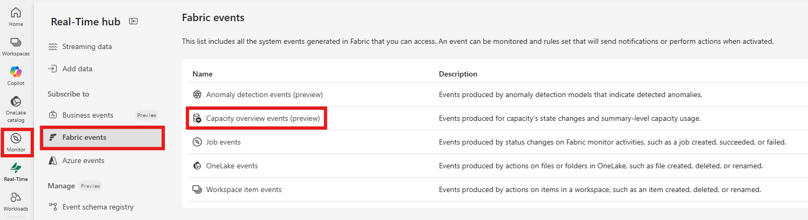
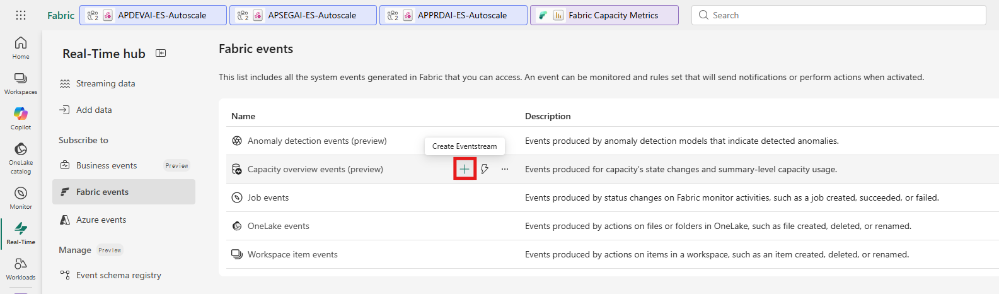
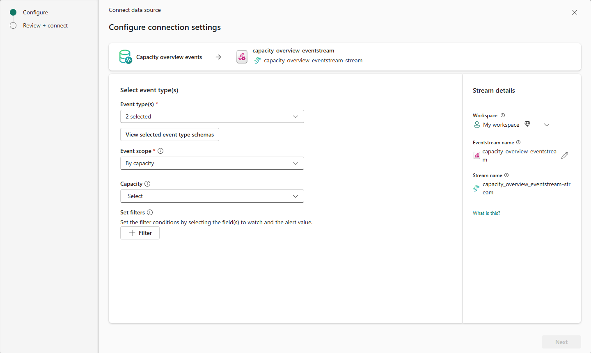
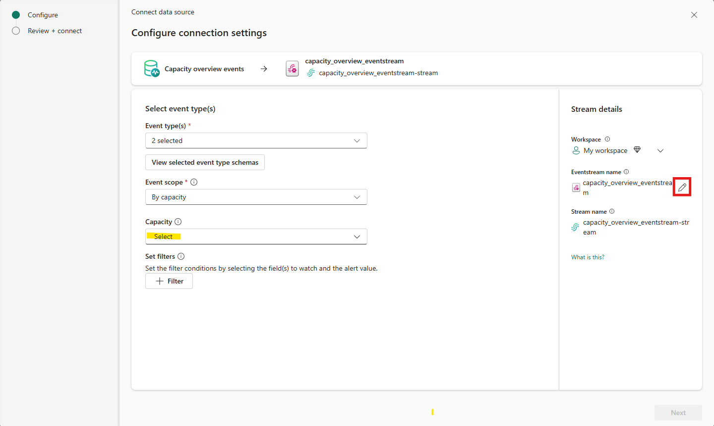
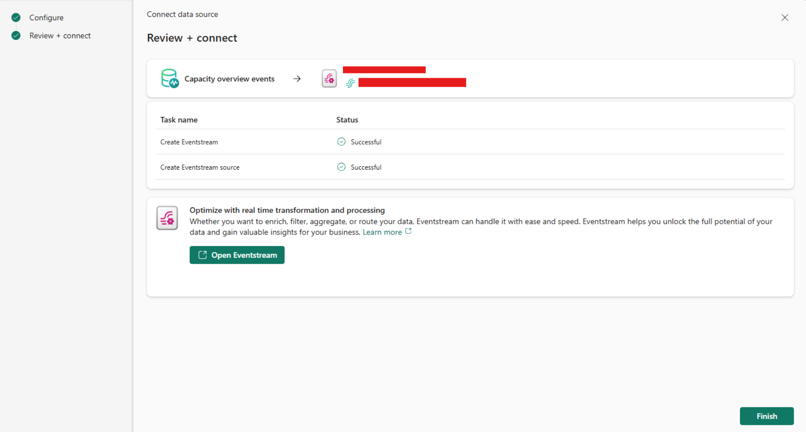
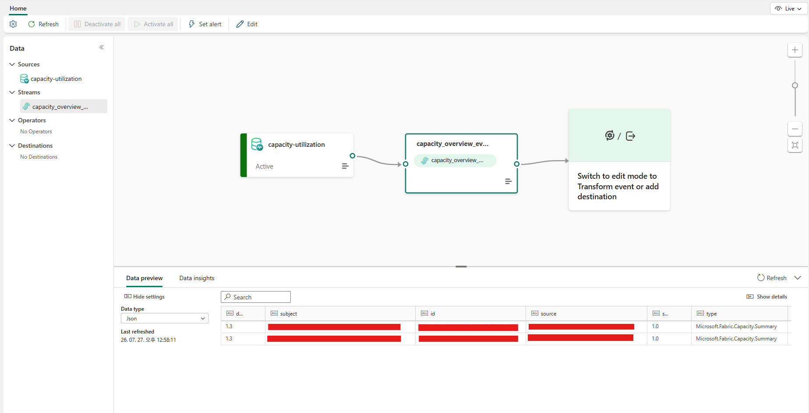
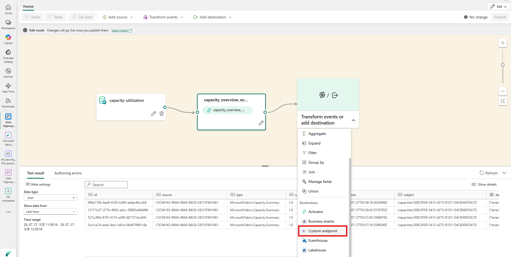
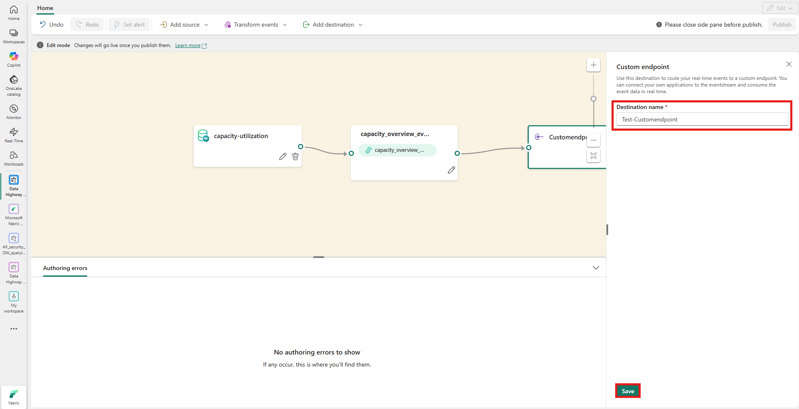
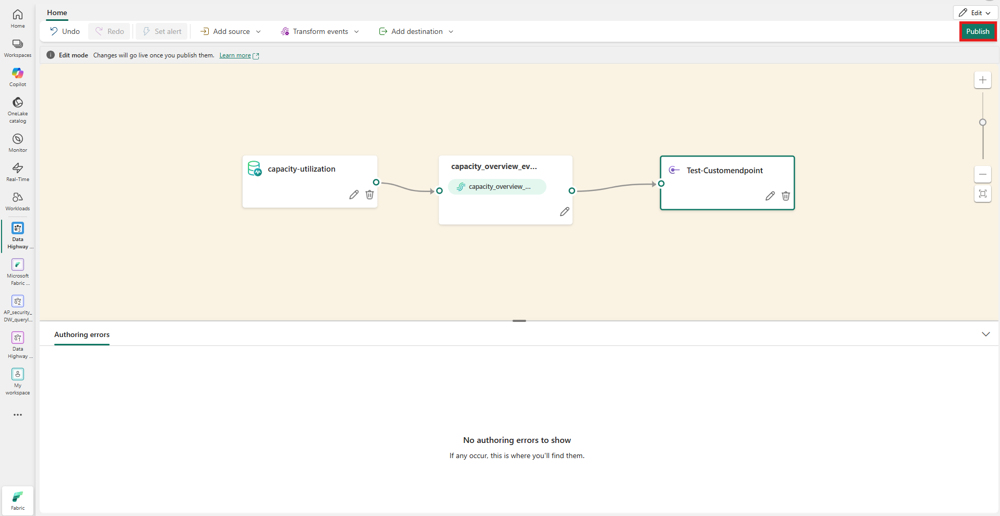
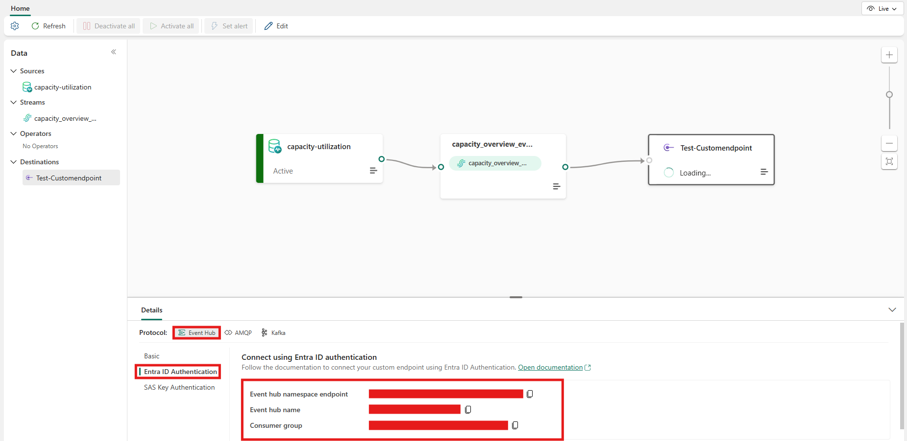

## Fabric 내 Eventstream 구성 및 Custom Endpoint 설정
1. Fabric Capacity Events 기반 Eventstream 생성
    
    
2. Target Capacity 선택 및 Eventstream name 설정 후 Next
    
    
3. Target Capacity 연결 완료
    
4. Eventstream의 Custom Endpoint 생성
    
5. Transform events or add destination 클릭해서 Custom endpoint 설정
    
    
6. Custom Endpoint 생성 후 Publish
    
7. Custom Endpoint 정보 확인
    