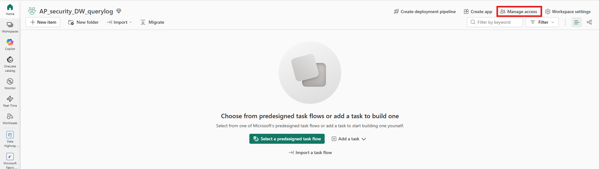
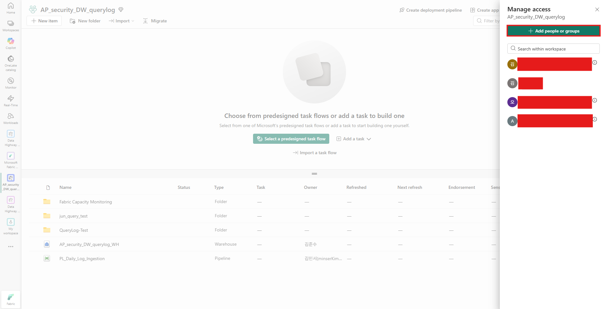
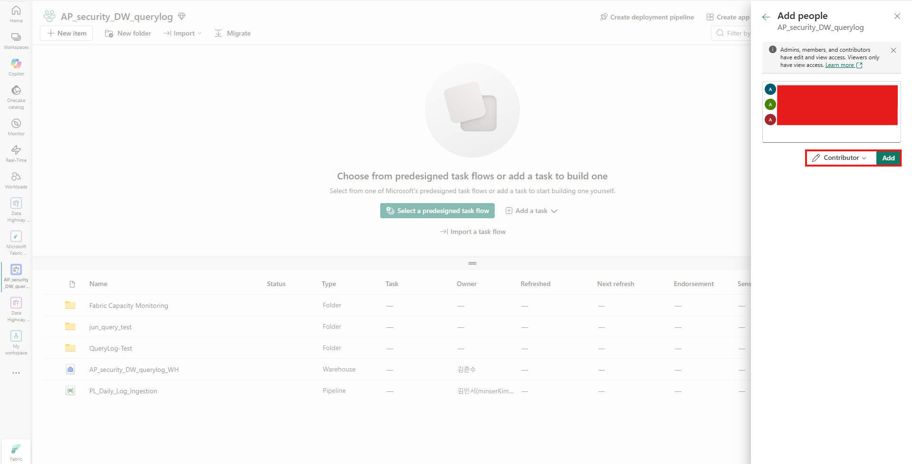

## AKS Cronjob 구성
1. Cronjob > Custom Endpoint 접근을 위한 Outbound 허용
    - 대상 환경: DEV / STG / PRD
    - Direction: Outbound
    - Destination: *.servicebus.windows.net
    - Protocol: HTTPS
    - Port: TCP 443
    - 용도: Fabric Eventstream(Event Hub Protocol) 연계를 통한 Fabric Capacity 사용량 데이터 수신
2. AKS Cronjob > Fabric Workscape 접근을 위한 Contributor 권한 부여
   
   
   
3. Utilization 호출 Python Code 준비
    - fabric_eventstream_capacity_sample.py
```python
#!/usr/bin/env python3
"""
Sample: Read Microsoft Fabric Capacity Summary from Eventstream Custom Endpoint.

This sample:
- Connects to a Microsoft Fabric Eventstream Custom Endpoint
  through the Event Hubs-compatible interface.
- Uses Microsoft Entra ID authentication via DefaultAzureCredential.
- Receives one Microsoft.Fabric.Capacity.Summary event.
- Calculates Fabric Capacity utilization.
- Exits after processing one matching event.

This script is READ ONLY.
It does NOT modify or scale Fabric Capacity.
"""

import os
import sys

from azure.eventhub import (
    EventHubConsumerClient,
    TransportType,
)
from azure.identity import DefaultAzureCredential


# ============================================================
# Configuration
# ============================================================

EVENTHUB_NAMESPACE = os.getenv(
    "FABRIC_EVENTHUB_NAMESPACE"
)

EVENTHUB_NAME = os.getenv(
    "FABRIC_EVENTHUB_NAME"
)

CONSUMER_GROUP = os.getenv(
    "FABRIC_EVENTHUB_CONSUMER_GROUP"
)

TARGET_CAPACITY_NAME = os.getenv(
    "FABRIC_CAPACITY_NAME"
)

WINDOW_SECONDS = 30
MAX_WAIT_SECONDS = 60

CAPACITY_SUMMARY_EVENT_TYPE = (
    "Microsoft.Fabric.Capacity.Summary"
)


# ============================================================
# Validation
# ============================================================

def validate_config() -> None:
    required = {
        "FABRIC_EVENTHUB_NAMESPACE":
            EVENTHUB_NAMESPACE,
        "FABRIC_EVENTHUB_NAME":
            EVENTHUB_NAME,
        "FABRIC_EVENTHUB_CONSUMER_GROUP":
            CONSUMER_GROUP,
        "FABRIC_CAPACITY_NAME":
            TARGET_CAPACITY_NAME,
    }

    missing = [
        name
        for name, value in required.items()
        if not value
    ]

    if missing:
        raise RuntimeError(
            "Missing required environment variables: "
            + ", ".join(missing)
        )


# ============================================================
# Utilization
# ============================================================

def calculate_utilization(
    data: dict,
) -> float:
    """
    Utilization(%)
      = capacityUnitMs
        / (baseCapacityUnits * 1000 * 30)
        * 100
    """

    capacity_unit_ms = float(
        data.get(
            "capacityUnitMs",
            0,
        )
    )

    base_capacity_units = float(
        data.get(
            "baseCapacityUnits",
            0,
        )
    )

    capacity_budget_ms = (
        base_capacity_units
        * 1000
        * WINDOW_SECONDS
    )

    if capacity_budget_ms <= 0:
        raise ValueError(
            "baseCapacityUnits must be greater than zero."
        )

    return (
        capacity_unit_ms
        / capacity_budget_ms
        * 100
    )


# ============================================================
# Output
# ============================================================

def print_capacity_summary(
    partition_context,
    event,
    data: dict,
) -> None:
    utilization = calculate_utilization(
        data
    )

    capacity_name = data.get(
        "capacityName",
        "UNKNOWN",
    )

    capacity_sku = data.get(
        "capacitySku",
        "UNKNOWN",
    )

    capacity_region = data.get(
        "capacityRegion",
        "UNKNOWN",
    )

    window_start = data.get(
        "windowStartTime",
        "UNKNOWN",
    )

    window_end = data.get(
        "windowEndTime",
        "UNKNOWN",
    )

    base_capacity_units = float(
        data.get(
            "baseCapacityUnits",
            0,
        )
    )

    capacity_unit_ms = float(
        data.get(
            "capacityUnitMs",
            0,
        )
    )

    print()
    print("=" * 72)
    print(" Microsoft Fabric Capacity Summary")
    print("=" * 72)

    print(
        f"Partition / Seq     : "
        f"{partition_context.partition_id}"
        f" / "
        f"{event.sequence_number}"
    )

    print("-" * 72)

    print(
        f"Capacity Name       : "
        f"{capacity_name}"
    )

    print(
        f"Capacity SKU        : "
        f"{capacity_sku}"
    )

    print(
        f"Region              : "
        f"{capacity_region}"
    )

    print("-" * 72)

    print(
        f"Window Start        : "
        f"{window_start}"
    )

    print(
        f"Window End          : "
        f"{window_end}"
    )

    print("-" * 72)

    print(
        f"Base Capacity Units : "
        f"{base_capacity_units:g}"
    )

    print(
        f"Capacity Unit Ms    : "
        f"{capacity_unit_ms:,.2f}"
    )

    print(
        f"Utilization         : "
        f"{utilization:.2f}%"
    )

    print("=" * 72)


# ============================================================
# Main
# ============================================================

def main() -> int:
    try:
        validate_config()

    except RuntimeError as exc:
        print(
            f"[CONFIG ERROR] {exc}"
        )
        return 1

    print("=" * 72)
    print(
        " Microsoft Fabric Eventstream "
        "One-Shot Sample"
    )
    print("=" * 72)

    print(
        "Authentication : "
        "Microsoft Entra ID"
    )

    print(
        "Credential     : "
        "DefaultAzureCredential"
    )

    print(
        "Transport      : "
        "AMQP over WebSocket / TCP 443"
    )

    print(
        "Mode           : "
        "ONE SHOT / READ ONLY"
    )

    print(
        f"Max Wait       : "
        f"{MAX_WAIT_SECONDS} seconds"
    )

    print("=" * 72)

    credential = DefaultAzureCredential()

    client = EventHubConsumerClient(
        fully_qualified_namespace=(
            EVENTHUB_NAMESPACE
        ),
        eventhub_name=(
            EVENTHUB_NAME
        ),
        consumer_group=(
            CONSUMER_GROUP
        ),
        credential=credential,
        transport_type=(
            TransportType.AmqpOverWebsocket
        ),
    )

    processed = False
    process_error = None

    # ========================================================
    # Batch Callback
    # ========================================================

    def on_event_batch(
        partition_context,
        events,
    ) -> None:
        nonlocal processed
        nonlocal process_error

        if not events:
            return

        try:
            for event in events:

                if processed:
                    break

                body = event.body_as_json()

                if not isinstance(
                    body,
                    dict,
                ):
                    continue

                event_type = body.get(
                    "type"
                )

                if (
                    event_type
                    != CAPACITY_SUMMARY_EVENT_TYPE
                ):
                    continue

                data = body.get(
                    "data"
                )

                if not isinstance(
                    data,
                    dict,
                ):
                    continue

                capacity_name = data.get(
                    "capacityName"
                )

                if (
                    capacity_name
                    != TARGET_CAPACITY_NAME
                ):
                    continue

                # --------------------------------------------
                # Process exactly one matching event
                # --------------------------------------------

                print_capacity_summary(
                    partition_context,
                    event,
                    data,
                )

                processed = True

                # Stop consumer after one event
                client.close()

                break

        except Exception as exc:
            process_error = exc
            client.close()

    # ========================================================
    # Error Callback
    # ========================================================

    def on_error(
        partition_context,
        error,
    ) -> None:
        nonlocal process_error

        process_error = error

        if partition_context:

            print(
                "[EVENT HUB ERROR] "
                f"Partition "
                f"{partition_context.partition_id}: "
                f"{error}"
            )

        else:

            print(
                f"[EVENT HUB ERROR] {error}"
            )

        client.close()

    # ========================================================
    # Receive
    # ========================================================

    try:
        print()
        print(
            "Waiting for one matching "
            "Capacity Summary event..."
        )

        with client:

            client.receive_batch(
                on_event_batch=(
                    on_event_batch
                ),

                max_batch_size=10,

                # Only new events
                starting_position="@latest",

                # Prevent infinite waiting
                max_wait_time=(
                    MAX_WAIT_SECONDS
                ),

                on_error=on_error,
            )

    except Exception as exc:

        if (
            process_error is None
            and not processed
        ):
            process_error = exc

    finally:

        credential.close()

        try:
            client.close()
        except Exception:
            pass

    # ========================================================
    # Result
    # ========================================================

    print()

    if processed:

        print(
            "[SUCCESS] "
            "One Capacity Summary event processed."
        )

        print(
            "[SUCCESS] "
            "Sample execution completed."
        )

        return 0

    if process_error is not None:

        print(
            "[ERROR] "
            f"{type(process_error).__name__}: "
            f"{process_error}"
        )

        return 1

    print(
        "[WARN] No matching event received "
        f"within {MAX_WAIT_SECONDS} seconds."
    )

    return 0


if __name__ == "__main__":
    sys.exit(
        main()
    )
```

4. Cronjob > Eventstream 호출(Utilization 확인)
- 작업영역에 권한이 없는 경우
```text
[ERROR] Fabric Eventstream authentication failed.

Event Hub      : <event-hub-name>
Consumer Group : <consumer-group>
HTTP Status    : 401
Error          : UnauthorizedAccess

Cause:
The identity used by the application does not have sufficient
permission to consume events from the Fabric Eventstream
Custom Endpoint.

Action:
Verify Microsoft Entra ID authentication and the Fabric
workspace permissions assigned to the Managed Identity
or Service Principal.
```
- 작업영역 권한 할당 후

```text
====================================================
 Starting Data Highway Python Batch Process
 Target Script : eventhub_test.py
 Environment   : ******
====================================================
========================================================================
 Fabric Eventstream CronJob One-Shot
========================================================================
Environment     : ******
Target Capacity : ******
Authentication  : Microsoft Entra ID
Transport       : AMQP over WebSocket / TCP 443
Execution Mode  : ONE SHOT
Max Wait        : 60 seconds
========================================================================
Waiting for one Capacity Summary event...
========================================================================
 Fabric Capacity Summary
========================================================================
Partition / Seq     : 2 / 647
------------------------------------------------------------------------
Capacity Name       : ******
Capacity SKU        : F2
Region              : Korea Central
------------------------------------------------------------------------
Window Start        : 2026-07-27T05:00:30.0000000Z
Window End          : 2026-07-27T05:01:00.0000000Z
------------------------------------------------------------------------
Base Capacity Units : 2
Capacity Unit Ms    : 7,487.45
Utilization         : 12.48%
------------------------------------------------------------------------
Interactive Delay   : 12.48%
Interactive Reject  : 12.48%
Background Reject   : 11.04%
Overage Active      : False
========================================================================
[SUCCESS] One Capacity Summary event processed.
[SUCCESS] CronJob execution completed.
```