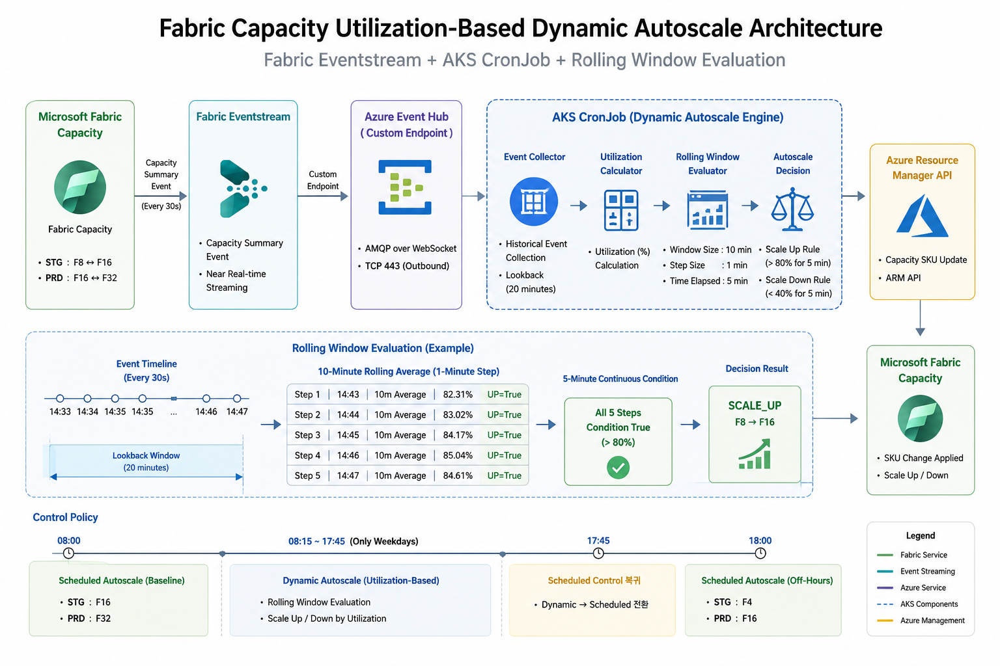

# Fabric Capacity Utilization-Based Dynamic Autoscale

Microsoft Fabric Capacity의 **Schedule 기반 SKU 제어**와  
Fabric Eventstream의 Capacity Summary Event를 활용한 **Utilization 기반 Dynamic Autoscale**을 결합한 구현 예제입니다.

기존 업무 시작/종료 시점의 Scheduled Autoscale 정책은 유지하면서, 업무시간 중에는 실제 Fabric Capacity 사용률을 기반으로 SKU를 동적으로 조정합니다.

---

## 1. Overview

기존 Fabric Capacity는 시간대별로 지정된 SKU를 적용하는 Schedule 기반 방식으로 운영됩니다.

본 구현에서는 기존 Schedule 정책을 제거하지 않고 다음과 같이 역할을 분리했습니다.

| 시간 | 제어 방식 | STG | PRD |
|---|---|---|---|
| 08:00 | Scheduled Autoscale | F16 | F32 |
| 08:15 ~ 17:45 | Dynamic Autoscale | F8 ↔ F16 | F16 ↔ F32 |
| 17:45 | Scheduled Control 복귀 | Schedule 정책 | Schedule 정책 |
| 18:00 | Scheduled Autoscale | F4 | F16 |

Dynamic Autoscale은 **평일(Monday ~ Friday) 08:15 ~ 17:45 KST**에만 동작합니다.

즉, 전체적인 제어 구조는 다음과 같습니다.

```text
08:00
  │
  ├─ Scheduled_Autoscale.py
  │      STG → F16
  │      PRD → F32
  │
08:15
  │
  ├─ Dynamic_Autoscale.py
  │      Utilization 기반 Dynamic Control 시작
  │
  │      STG : F8  ↔ F16
  │      PRD : F16 ↔ F32
  │
17:45
  │
  ├─ Dynamic Control 종료
  │      Scheduled Control로 제어권 복귀
  │
18:00
  │
  └─ Scheduled_Autoscale.py
         STG → F4
         PRD → F16
```

---

## 2. Architecture



전체 데이터 및 제어 흐름은 다음과 같습니다.

```text
Microsoft Fabric Capacity
        │
        │ Capacity Summary Event
        │ Every 30 seconds
        ▼
Fabric Eventstream
        │
        │ Custom Endpoint
        ▼
Azure Event Hub Endpoint
        │
        │ AMQP over WebSocket / TCP 443
        ▼
AKS CronJob
        │
        ├─ Historical Event Collection
        ├─ Utilization Calculation
        ├─ 10-minute Rolling Average
        ├─ 1-minute Step Evaluation
        ├─ 5-minute Continuous Condition
        └─ Autoscale Decision
                │
                ▼
Azure Resource Manager API
                │
                │ PATCH Fabric Capacity SKU
                ▼
Microsoft Fabric Capacity
```

AKS에서 Azure Resource Manager 및 Event Hub에 접근할 때 별도의 Access Key를 사용하지 않고 **AKS Workload Identity + DefaultAzureCredential**을 사용합니다.

---

## 3. Components

### Fabric Capacity

Autoscale 대상 Microsoft Fabric Capacity입니다.

환경별 Dynamic Autoscale 범위는 다음과 같습니다.

| Environment | Minimum | Maximum |
|---|---:|---:|
| STG | F8 | F16 |
| PRD | F16 | F32 |

Dynamic Autoscale은 해당 범위 안에서만 SKU를 변경합니다.

수동 작업 등의 목적으로 F64가 적용된 경우 Dynamic Autoscale 대상에서 제외하여 자동 Scale Down을 방지합니다.

### Fabric Eventstream

Fabric Capacity에서 발생하는 `Capacity Summary Event`를 수집합니다.

Dynamic Autoscale에서는 Eventstream Custom Endpoint를 통해 전달되는 Capacity Summary Event의 데이터를 이용하여 Capacity Utilization을 계산합니다.

주요 활용 값은 다음과 같습니다.

```text
capacityName
capacitySku
capacityRegion
capacityUnitMs
baseCapacityUnits
windowStartTime
windowEndTime
interactiveDelayThresholdPercentage
interactiveRejectionThresholdPercentage
backgroundRejectionThresholdPercentage
overageBillingProtectionActive
overageTotalCapacityUnitMs
```

### AKS CronJob

AKS CronJob이 일정 주기로 실행되어 Eventstream의 Capacity Summary Event를 수집하고 Autoscale 조건을 평가합니다.

```text
CronJob
   │
   ├─ Eventstream Historical Event 조회
   ├─ Target Capacity Event Filtering
   ├─ Utilization 계산
   ├─ Rolling Window 생성
   ├─ 5분 연속 조건 평가
   └─ ARM API를 통한 SKU 변경
```

---

## 4. Utilization Calculation

Fabric Capacity Summary Event에서 다음 값을 사용합니다.

```text
capacityUnitMs
baseCapacityUnits
```

Capacity Summary Event의 기본 Window가 30초인 경우 Utilization은 다음과 같이 계산합니다.

```text
Utilization (%)

                 capacityUnitMs
------------------------------------------------ × 100
baseCapacityUnits × 1000 × WindowSeconds
```

예를 들어 다음과 같은 Event가 수신된 경우:

```text
baseCapacityUnits = 8
capacityUnitMs     = 119472
window             = 30 seconds
```

계산식은 다음과 같습니다.

```text
119472
-------------------- × 100
8 × 1000 × 30

= 49.78%
```

이 값이 각 Capacity Summary Event의 Utilization Sample이 됩니다.

---

## 5. Rolling Window Evaluation

단순히 CronJob 실행 시점의 Utilization 한 건을 기준으로 Scale Up/Down을 결정하지 않습니다.

Microsoft Fabric Activator에서 구성했던 정책과 동일한 개념으로 **Historical Event 기반 Rolling Window Evaluation**을 수행합니다.

### Rule

| Property | Value |
|---|---:|
| Window Size | 10 minutes |
| Step Size | 1 minute |
| Time Elapsed | 5 minutes |
| Scale Up | Average > 80% |
| Scale Down | Average < 40% |

평가 시점마다 직전 10분의 Capacity Summary Event를 조회하여 평균 Utilization을 계산합니다.

```text
14:43 → 14:33 ~ 14:43 Average
14:44 → 14:34 ~ 14:44 Average
14:45 → 14:35 ~ 14:45 Average
14:46 → 14:36 ~ 14:46 Average
14:47 → 14:37 ~ 14:47 Average
```

Capacity Summary Event가 30초 단위로 발생하는 경우 하나의 10분 Window에는 약 20개의 Event가 포함됩니다.

---

## 6. Scale Up Rule

Scale Up 조건은 다음과 같습니다.

```text
10-minute Average Utilization > 80%
Step Size                      = 1 minute
Time Elapsed                   = 5 minutes
```

한 번 80%를 초과했다고 바로 Scale Up하지 않습니다.

최근 5개의 1분 Step에서 각각 계산된 10분 평균이 **모두 80%를 초과**해야 합니다.

예:

```text
[Step 1] 14:43 | AVG=82.31% | UP=True
[Step 2] 14:44 | AVG=83.02% | UP=True
[Step 3] 14:45 | AVG=84.17% | UP=True
[Step 4] 14:46 | AVG=85.04% | UP=True
[Step 5] 14:47 | AVG=84.61% | UP=True
```

결과:

```text
STG : F8  → F16
PRD : F16 → F32
```

이미 Dynamic Maximum SKU에 도달한 경우 현재 SKU를 유지합니다.

---

## 7. Scale Down Rule

Scale Down 조건은 다음과 같습니다.

```text
10-minute Average Utilization < 40%
Step Size                      = 1 minute
Time Elapsed                   = 5 minutes
```

최근 5개의 Rolling Window Average가 모두 40% 미만인 경우 Scale Down을 수행합니다.

예:

```text
[Step 1] 14:43 | AVG=32.18% | DOWN=True
[Step 2] 14:44 | AVG=31.82% | DOWN=True
[Step 3] 14:45 | AVG=30.91% | DOWN=True
[Step 4] 14:46 | AVG=29.74% | DOWN=True
[Step 5] 14:47 | AVG=28.63% | DOWN=True
```

결과:

```text
STG : F16 → F8
PRD : F32 → F16
```

---

## 8. Maintain Rule

Scale Up과 Scale Down 조건 어느 쪽도 5분 동안 지속되지 않으면 SKU를 변경하지 않습니다.

예:

```text
[Step 1] AVG=49.72% | UP=False | DOWN=False
[Step 2] AVG=49.72% | UP=False | DOWN=False
[Step 3] AVG=49.72% | UP=False | DOWN=False
[Step 4] AVG=49.72% | UP=False | DOWN=False
[Step 5] AVG=49.72% | UP=False | DOWN=False
```

결과:

```text
Action      : MAINTAIN
Current SKU : F8
Target SKU  : F8
```

40% ~ 80% 사이의 Utilization은 기본적으로 Maintain 영역입니다.

---

## 9. Scheduled + Dynamic Autoscale

본 구조에서 중요한 부분은 Dynamic Autoscale이 기존 Scheduled Autoscale을 완전히 대체하지 않는다는 점입니다.

두 Autoscale은 서로 다른 시간대의 제어 책임을 가집니다.

### Scheduled_Autoscale.py

기존 Schedule 기반 Capacity 제어를 담당합니다.

주요 역할:

```text
08:00
STG → F16
PRD → F32

18:00
STG → F4
PRD → F16
```

08:15 ~ 17:45에는 Schedule 기반 SKU 변경을 수행하지 않고 Dynamic Autoscale에 제어권을 위임합니다.

### Dynamic_Autoscale.py

업무시간 중 실제 Capacity Utilization을 기반으로 SKU를 제어합니다.

```text
08:15 ~ 17:45

STG
F8 ↔ F16

PRD
F16 ↔ F32
```

17:45 이후에는 Dynamic Autoscale이 더 이상 SKU를 변경하지 않습니다.

이를 통해 18:00 Scheduled Autoscale이 정상적으로 업무 종료 정책을 적용할 수 있습니다.

---

## 10. Safety Controls

운영 안정성을 위해 다음 보호 로직을 적용했습니다.

- Dynamic Autoscale은 평일 08:15 ~ 17:45 KST에만 동작
- 업무 시작 Baseline SKU는 기존 Schedule 정책에서 설정
- 업무 종료 SKU Down은 기존 Schedule 정책에서 수행
- STG/PRD 환경에서만 Dynamic Autoscale 허용
- Capacity가 `Active` 상태가 아니면 Dynamic Autoscale 미수행
- Dynamic SKU 범위를 벗어난 SKU는 자동 변경하지 않음
- 수동 F64 적용 상태에서는 Dynamic Autoscale Bypass
- Historical Event가 충분하지 않으면 SKU 변경 미수행
- 1회 Threshold 초과가 아닌 지속 조건을 기준으로 SKU 변경
- ARM API 인증은 AKS Workload Identity 사용

---

## 11. Authentication

Azure 인증에는 `DefaultAzureCredential`을 사용합니다.

```python
credential = DefaultAzureCredential()
```

AKS에서는 Workload Identity를 통해 Azure Entra ID Token을 발급받습니다.

```text
AKS Pod
   │
   │ ServiceAccount
   ▼
AKS Workload Identity
   │
   ▼
Microsoft Entra ID
   │
   ├─ Event Hub Access
   │
   └─ Azure Resource Manager Access
```

ARM API Token Scope:

```text
https://management.azure.com/.default
```

이를 통해 Secret, Access Key 또는 Service Principal Client Secret을 코드에 직접 저장하지 않습니다.

---

## 12. Network

Fabric Eventstream Custom Endpoint와 AKS 간 Event 수신에는 다음 방식을 사용합니다.

```text
AMQP over WebSocket
TCP 443
```

Python Event Hub Client에서는 다음 Transport를 사용합니다.

```python
TransportType.AmqpOverWebsocket
```

Private Network 또는 방화벽이 적용된 환경에서는 AKS에서 Event Hub Endpoint의 TCP 443 통신이 허용되어야 합니다.

---

## 13. Example Execution Log

정상적인 Maintain 상태의 실행 예시는 다음과 같습니다.

```text
====================================================
 Starting Data Highway Python Batch Process
 Target Script : Dynamic_Autoscale.py
 Environment   : stg
====================================================

========================================================================
Fabric Capacity Dynamic Autoscale
========================================================================
Environment       : STG
Capacity          : apstgaifabric
Current KST       : 2026-07-30 14:47:33 (Thursday)
Time Window       : Monday-Friday / 08:15 - 17:45 KST
Dynamic SKU Range : F8 <-> F16
Rule Window       : 10 minutes
Rule Step         : 1 minute
Time Elapsed      : 5 minutes
Scale Up          : 10m AVG > 80.00% for 5 minutes
Scale Down        : 10m AVG < 40.00% for 5 minutes

========================================================================
Current Fabric Capacity
========================================================================
Current SKU : F8
State       : Active

========================================================================
Historical Event Collection
========================================================================
Lookback Start : 2026-07-30 05:27:33 UTC
Lookback End   : 2026-07-30 05:47:33 UTC
Lookback       : 20 minutes
Events Found   : 40

========================================================================
Activator-compatible Rolling Evaluation
========================================================================
Rule : 10-minute Average / 1-minute Step

[Step 1] 14:43 | Events=20 | AVG=49.72% | UP=False | DOWN=False
[Step 2] 14:44 | Events=20 | AVG=49.72% | UP=False | DOWN=False
[Step 3] 14:45 | Events=20 | AVG=49.72% | UP=False | DOWN=False
[Step 4] 14:46 | Events=20 | AVG=49.72% | UP=False | DOWN=False
[Step 5] 14:47 | Events=20 | AVG=49.72% | UP=False | DOWN=False

========================================================================
Dynamic Autoscale Decision
========================================================================
Action      : MAINTAIN
Current SKU : F8
Target SKU  : F8
Reason      : Neither scale-up nor scale-down condition has remained true for 5 minutes.

[INFO] No Fabric Capacity SKU change required.
```

---

## 14. Repository Structure

```text
Fabric Eventstream Custom Endpoint/
│
├─ 01-Fabric Eventstream 구성/
│  └─ readme.md
│
├─ 02-AKS CronJob 구성/
│  └─ readme.md
│
├─ 03-Utilization Based Autoscale/
│  ├─ Dynamic_Autoscale.py
│  ├─ Scheduled_Autoscale.py
│  └─ readme.md
│
├─ img/
│  ├─ 01/
│  ├─ 02/
│  └─ 03/
│     └─ Architecture.png
│
├─ architecture.png
├─ fabric_eventstream_capacity_sample.py
└─ README.md
```

### Dynamic_Autoscale.py

Fabric Eventstream의 Historical Capacity Summary Event를 기반으로 Utilization을 계산하고 Rolling Window 조건을 평가하여 업무시간 중 Fabric Capacity SKU를 동적으로 조정합니다.

### Scheduled_Autoscale.py

기존 Schedule 기반 Fabric Capacity SKU 정책을 담당합니다.

업무 시작 시 Baseline Capacity를 확보하고, Dynamic Autoscale 종료 후 업무 종료 시간에 기존 Schedule 정책에 따라 SKU를 조정합니다.

---

## 15. Design Goal

본 구현의 핵심 목적은 단순 Threshold 기반 Autoscale이 아닙니다.

```text
Real-time Single Event
        ↓
Immediate Scale
```

방식이 아니라,

```text
Historical Capacity Events
        ↓
10-minute Rolling Average
        ↓
1-minute Step Evaluation
        ↓
5-minute Continuous Condition
        ↓
Scale Up / Scale Down
```

방식으로 구성하여 일시적인 Utilization 변동에 의한 불필요한 SKU 변경을 방지합니다.

또한 기존 Schedule 기반 Capacity 정책을 유지하면서 Dynamic Autoscale을 업무시간에만 적용하여 **Baseline Capacity 보장과 실제 부하 기반 비용 최적화를 동시에 수행**하도록 설계했습니다.

---

## 16. Author

**김민서 (MEGAZONECLOUD)**

Created: 2026-07-30