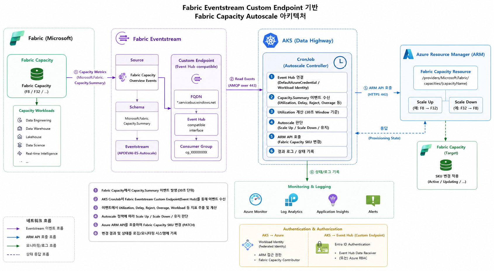

# Fabric Eventstream Custom Endpoint 기반 Capacity Autoscaling

Microsoft Fabric Capacity에서 발생하는 실시간 Capacity Summary 이벤트를 Fabric Eventstream을 통해 수집하고,  
AKS CronJob에서 해당 이벤트의 Capacity Utilization을 분석하여 Azure ARM API를 통해 Fabric Capacity SKU를 자동으로 조정하는 Autoscaling 구조입니다.



---

## 1. Overview

기존 Fabric 기반 Autoscaling 방식은 Fabric Activator와 Notebook을 이용하여 Capacity 사용률을 판단하고 SKU를 변경하는 구조로 구성할 수 있습니다.

그러나 Notebook 기반 방식은 Autoscaling을 수행할 때마다 Fabric Notebook 세션을 생성해야 하며, 세션 초기화 및 실행 준비 시간이 필요합니다. 또한 Autoscaling 자체를 위해 Fabric Compute Resource를 추가로 사용하는 구조가 됩니다.

본 프로젝트에서는 Fabric Capacity에서 발생하는 `Microsoft.Fabric.Capacity.Summary` 이벤트를 **Fabric Eventstream Custom Endpoint**를 통해 AKS에서 직접 수신하도록 구성합니다.

AKS CronJob은 일정 주기마다 실행되어 최신 Capacity Summary 이벤트를 수신하고 Utilization을 계산한 뒤, 설정된 Autoscaling 정책에 따라 Azure ARM API를 호출하여 Capacity SKU를 조정합니다.

### 주요 특징

- Fabric Capacity Summary Event 기반 사용률 확인
- Fabric Eventstream Custom Endpoint 사용
- Event Hubs Compatible Endpoint를 통한 외부 Consumer 연계
- Microsoft Entra ID 기반 인증
- AKS Workload Identity 사용 가능
- AMQP over WebSocket을 통한 TCP 443 통신
- AKS CronJob 기반 One-Shot 실행
- Azure ARM API 기반 Fabric Capacity SKU 변경
- DEV / STG / PRD 환경별 독립적인 구성 가능
- Connection String 및 Client Secret 없이 구성 가능

---

## 2. Architecture

```text
┌─────────────────────────────────────────────┐
│          Microsoft Fabric Capacity          │
│                                             │
│  F2 / F4 / F8 / F16 / F32 / F64 ...        │
└──────────────────────┬──────────────────────┘
                       │
                       │ Capacity Metrics Event
                       │ Microsoft.Fabric.Capacity.Summary
                       ▼
┌─────────────────────────────────────────────┐
│              Fabric Eventstream             │
│                                             │
│  Fabric Capacity Events                     │
│  - capacityUnitMs                           │
│  - baseCapacityUnits                        │
│  - capacitySku                              │
│  - windowStartTime / windowEndTime          │
│  - Threshold / Overage Metrics              │
└──────────────────────┬──────────────────────┘
                       │
                       │ Custom Endpoint
                       │ Event Hubs Compatible
                       ▼
┌─────────────────────────────────────────────┐
│         Eventstream Custom Endpoint         │
│                                             │
│  Namespace    : *.servicebus.windows.net    │
│  Event Hub    : <event-hub-name>            │
│  ConsumerGroup: <consumer-group>            │
│                                             │
│  AMQP over WebSocket / TCP 443              │
└──────────────────────┬──────────────────────┘
                       │
                       │ Microsoft Entra ID
                       │ Workload Identity
                       ▼
┌─────────────────────────────────────────────┐
│                  AKS                        │
│                                             │
│              Kubernetes CronJob             │
│                       │                     │
│                       ▼                     │
│              Python Autoscaler              │
│                                             │
│  1. Eventstream Event 수신                  │
│  2. Capacity Summary Filtering              │
│  3. Utilization 계산                        │
│  4. Scale Policy 판단                       │
└──────────────────────┬──────────────────────┘
                       │
                       │ ARM REST API
                       │ Microsoft Entra ID
                       ▼
┌─────────────────────────────────────────────┐
│             Azure Resource Manager          │
│                                             │
│   Microsoft.Fabric/capacities               │
│                       │                     │
│                       ▼                     │
│          Fabric Capacity SKU 변경           │
│                                             │
│        Scale Up / Scale Down                │
└─────────────────────────────────────────────┘
```

전체 데이터 흐름은 다음과 같습니다.

```text
Fabric Capacity Metrics Event
        ↓
Fabric Eventstream
        ↓
Microsoft.Fabric.Capacity.Summary
        ↓
Custom Endpoint
(Event Hubs Compatible Endpoint)
        ↓
AMQP over WebSocket / TCP 443
        ↓
AKS CronJob
        ↓
Capacity Summary Event 수신
        ↓
Utilization 계산
        ↓
Autoscaling Policy 판단
        ↓
Azure ARM API
        ↓
Fabric Capacity SKU
Scale Up / Scale Down
```

> 본 구조는 Eventstream 이벤트가 AKS를 직접 Trigger하는 완전한 Event-Driven 구조가 아닙니다.  
> AKS CronJob이 정해진 주기에 따라 실행되고 Eventstream Custom Endpoint에서 최신 Capacity 이벤트를 소비하는 **Event-driven Metrics + Scheduled Control** 구조입니다.

---

# 3. Fabric Eventstream 구성

## 3.1 Fabric Capacity Events 기반 Eventstream 생성

Fabric Workspace에서 Capacity 관련 이벤트를 수신하기 위한 Eventstream을 생성합니다.

일반적인 Eventstream Source를 임의로 추가하는 방식과 달리 본 구성에서는 Fabric에서 제공하는 Capacity Event를 Source로 사용합니다.

수신 대상 이벤트:

```text
Microsoft.Fabric.Capacity.Summary
```

해당 이벤트에는 특정 시점의 Capacity 상태와 CU 사용량 정보가 포함됩니다.

대표적인 데이터는 다음과 같습니다.

| Field | Description |
|---|---|
| `capacityId` | Fabric Capacity ID |
| `capacityName` | Capacity 이름 |
| `capacitySku` | 현재 Capacity SKU |
| `capacityRegion` | Capacity Region |
| `windowStartTime` | 측정 Window 시작 시간 |
| `windowEndTime` | 측정 Window 종료 시간 |
| `baseCapacityUnits` | 현재 Capacity의 기본 CU |
| `capacityUnitMs` | 해당 Window에서 사용된 Capacity Unit Milliseconds |
| `utilizationBackground` | Background Workload 사용량 |
| `utilizationInteractive` | Interactive Workload 사용량 |
| `interactiveDelayThresholdPercentage` | Interactive Delay 관련 지표 |
| `interactiveRejectionThresholdPercentage` | Interactive Rejection 관련 지표 |
| `backgroundRejectionThresholdPercentage` | Background Rejection 관련 지표 |
| `overageTotalCapacityUnitMs` | Overage Capacity 사용량 |
| `overageBillingProtectionActive` | Overage Billing Protection 상태 |

Eventstream 생성 후 반드시 **Publish**하여 이벤트가 정상적으로 흐르도록 구성합니다.

---

## 3.2 Eventstream Custom Endpoint 구성

생성한 Eventstream의 Custom Endpoint를 이용하여 AKS에서 Eventstream 데이터를 소비합니다.

Custom Endpoint에서는 Event Hubs Compatible Interface를 통해 다음과 같은 접속 정보를 확인할 수 있습니다.

```text
Namespace Endpoint
Event Hub Name
Consumer Group
```

예제:

```text
Namespace      : <namespace>.servicebus.windows.net
Event Hub      : <event-hub-name>
Consumer Group : <consumer-group>
```

> `*.servicebus.windows.net` 주소가 사용되지만 본 프로젝트에서 별도의 Azure Event Hubs Namespace를 생성하는 것은 아닙니다. Fabric Eventstream Custom Endpoint에서 외부 Consumer 연계를 위해 제공하는 Event Hubs 호환 Endpoint를 사용합니다.

---

# 4. Network 구성

## 4.1 AKS → Eventstream Custom Endpoint Outbound 허용

AKS Pod에서 Eventstream Custom Endpoint에 접근할 수 있도록 Outbound 통신이 필요합니다.

환경별 DEV / STG / PRD AKS에 대해 동일하게 검토합니다.

| Item | Value |
|---|---|
| Direction | Outbound |
| Destination | `*.servicebus.windows.net` |
| Protocol | TLS / AMQP over WebSocket |
| Port | TCP 443 |
| Source | Data Highway AKS |
| Purpose | Fabric Eventstream Capacity Summary Event 수신 |

기본 Event Hubs AMQP 연결은 TCP 5671을 사용할 수 있지만, 제한적인 Enterprise Network 환경에서는 해당 Port가 차단되어 있을 수 있습니다.

본 프로젝트에서는 다음 Transport를 사용합니다.

```python
transport_type=TransportType.AmqpOverWebsocket
```

따라서 통신 구조는 다음과 같습니다.

```text
AKS Pod
   │
   │ AMQP over WebSocket
   │ TCP 443
   ▼
*.servicebus.windows.net
   │
   ▼
Fabric Eventstream Custom Endpoint
```

POC 과정에서도 TCP 5671은 차단된 반면 TCP 443 연결이 가능한 환경을 확인하였으며, 이에 따라 WebSocket Transport를 적용하였습니다.

---

# 5. Authentication / Authorization

## 5.1 Microsoft Entra ID 인증

Custom Endpoint 접근 시 Connection String이나 SAS Key를 애플리케이션 코드에 저장하지 않고 Microsoft Entra ID 인증을 사용합니다.

Python SDK에서는 다음과 같이 구성합니다.

```python
from azure.identity import DefaultAzureCredential

credential = DefaultAzureCredential()
```

AKS 환경에서는 `DefaultAzureCredential`이 AKS Workload Identity를 통해 Token을 획득할 수 있도록 구성합니다.

```text
AKS Pod
   ↓
Kubernetes ServiceAccount
   ↓
AKS Workload Identity
   ↓
Microsoft Entra ID
   ↓
Access Token
   ↓
Fabric Eventstream
```

이를 통해 애플리케이션 코드에 다음과 같은 Credential을 직접 저장할 필요가 없습니다.

```text
Client Secret
SAS Key
Event Hub Connection String
Account Key
```

---

## 5.2 Fabric Workspace 권한

AKS에서 사용하는 Managed Identity / Workload Identity가 Eventstream이 위치한 Fabric Workspace에 접근할 수 있도록 적절한 Workspace 권한을 부여합니다.

본 POC에서는 Workspace `Contributor` 권한을 기준으로 구성하였습니다.

권한이 없거나 올바른 Identity가 사용되지 않는 경우 다음과 같은 인증 오류가 발생할 수 있습니다.

```text
AuthenticationError(
    'Management authentication failed.
     Status code: 401

     Error condition:
     ErrorCondition.UnauthorizedAccess'
)
```

따라서 401 오류 발생 시 다음 항목을 우선 확인합니다.

```text
1. AKS Pod가 사용하는 Workload Identity Client ID
2. Kubernetes ServiceAccount Annotation
3. Federated Credential 구성
4. Fabric Workspace 권한
5. Eventstream이 위치한 Workspace
6. Event Hub Name / Consumer Group 설정
```

---

# 6. AKS CronJob 구성

## 6.1 CronJob 실행 방식

Autoscaler는 상시 실행되는 Consumer Application으로 구성하지 않습니다.

Kubernetes CronJob이 일정 주기마다 Python Application을 실행하며, Application은 필요한 Capacity Summary 이벤트를 처리한 뒤 종료하는 **One-Shot 방식**으로 구성합니다.

```text
CronJob Schedule
      ↓
Job 생성
      ↓
Pod 생성
      ↓
Python Autoscaler 실행
      ↓
Eventstream 연결
      ↓
Capacity Summary 수신
      ↓
Utilization 계산
      ↓
Scale 판단 / 실행
      ↓
Process Exit
      ↓
Pod Completed
```

이 방식은 Consumer Pod를 상시 유지할 필요가 없으며 기존 Batch Application 운영 구조와 통합하기 쉽다는 장점이 있습니다.

CronJob 중복 실행 방지를 위해 다음 설정을 권장합니다.

```yaml
spec:
  concurrencyPolicy: Forbid
```

이전 Job이 아직 종료되지 않은 상태에서 다음 Schedule이 도래할 경우 중복 Autoscaling이 실행되는 것을 방지합니다.

---

# 7. Capacity Utilization 계산

Fabric Capacity Summary Event에서 다음 값을 사용합니다.

```text
capacityUnitMs
baseCapacityUnits
windowStartTime
windowEndTime
```

현재 Capacity Summary Event의 Window가 30초인 경우 Capacity가 사용할 수 있는 총 Capacity Budget은 다음과 같습니다.

```text
Capacity Budget (ms)
    = baseCapacityUnits
      × 1000
      × Window Seconds
```

Utilization은 다음과 같이 계산합니다.

```text
Utilization (%)
    = capacityUnitMs
      / Capacity Budget (ms)
      × 100
```

즉:

```text
Utilization (%)
    = capacityUnitMs
      / (baseCapacityUnits × 1000 × 30)
      × 100
```

예를 들어 F32 Capacity에서:

```text
baseCapacityUnits = 32
Window            = 30 seconds
capacityUnitMs    = 161,367.99
```

이면:

```text
Capacity Budget
= 32 × 1000 × 30
= 960,000 CUms
```

따라서:

```text
Utilization
= 161,367.99 / 960,000 × 100
≈ 16.81%
```

가 됩니다.

---

# 8. Event Consumer

Python Application은 Azure Event Hubs SDK를 사용하여 Fabric Eventstream Custom Endpoint에 연결합니다.

```python
from azure.eventhub import (
    EventHubConsumerClient,
    TransportType,
)

client = EventHubConsumerClient(
    fully_qualified_namespace=EVENTHUB_NAMESPACE,
    eventhub_name=EVENTHUB_NAME,
    consumer_group=CONSUMER_GROUP,
    credential=credential,
    transport_type=TransportType.AmqpOverWebsocket,
)
```

수신 이벤트 중 다음 Event Type만 처리합니다.

```python
body.get("type") == "Microsoft.Fabric.Capacity.Summary"
```

또한 DEV/STG/PRD Eventstream 또는 여러 Capacity Event가 존재할 수 있으므로 Capacity Name을 추가로 검증합니다.

```python
data.get("capacityName") == TARGET_CAPACITY_NAME
```

이를 통해 Autoscaler가 잘못된 Capacity의 Metric을 기준으로 동작하는 것을 방지합니다.

---

# 9. Autoscaling Decision

전체 Autoscaling Logic은 다음 구조로 동작합니다.

```text
Capacity Summary Event
        ↓
Target Capacity 검증
        ↓
Utilization 계산
        ↓
현재 Fabric SKU 조회
        ↓
환경별 SKU Min / Max 검증
        ↓
Autoscaling Threshold 판단
        ↓
Scale Up / Maintain / Scale Down
        ↓
Azure ARM API
```

SKU는 단계적으로 관리할 수 있습니다.

```text
F2
 ↓
F4
 ↓
F8
 ↓
F16
 ↓
F32
 ↓
F64
```

환경별로 허용할 최소/최대 SKU를 별도로 지정하여 Autoscaler가 허용 범위를 벗어나지 않도록 구성합니다.

예:

```text
DEV : F2  ~ F8
STG : F4  ~ F64
PRD : F16 ~ F64
```

> 실제 SKU 범위와 Threshold는 각 환경의 운영 정책에 따라 설정합니다.

---

# 10. Fabric Capacity SKU 변경

Autoscaling이 필요하다고 판단되면 Azure Resource Manager를 통해 현재 Fabric Capacity Resource를 제어합니다.

대상 Resource Provider:

```text
Microsoft.Fabric/capacities
```

개념적인 요청 구조는 다음과 같습니다.

```text
AKS Workload Identity
        ↓
Azure Management Access Token
        ↓
Azure Resource Manager
        ↓
Microsoft.Fabric/capacities
        ↓
SKU PATCH
        ↓
Fabric Capacity
```

따라서 Workload Identity에는 Eventstream을 읽기 위한 Fabric Workspace 권한뿐 아니라, 실제 Autoscaling을 수행하는 경우 대상 Azure Fabric Capacity Resource를 변경할 수 있는 별도의 Azure RBAC 권한이 필요합니다.

즉 두 권한의 목적은 구분됩니다.

```text
Fabric Workspace Permission
        ↓
Eventstream Capacity Event 수신

Azure RBAC
        ↓
Fabric Capacity SKU 변경
```

---

# 11. Environment Configuration

DEV / STG / PRD 환경별 Eventstream과 Capacity를 분리하여 구성할 수 있습니다.

예:

```text
DEV
 ├─ Fabric Capacity
 ├─ Fabric Capacity Eventstream
 ├─ Custom Endpoint
 └─ AKS CronJob

STG
 ├─ Fabric Capacity
 ├─ Fabric Capacity Eventstream
 ├─ Custom Endpoint
 └─ AKS CronJob

PRD
 ├─ Fabric Capacity
 ├─ Fabric Capacity Eventstream
 ├─ Custom Endpoint
 └─ AKS CronJob
```

Eventstream Custom Endpoint 정보는 애플리케이션 코드에 하드코딩하지 않고 환경변수 또는 Secret Management 시스템을 통해 주입하는 것을 권장합니다.

예:

```text
FABRIC_EVENTHUB_NAMESPACE
FABRIC_EVENTHUB_NAME
FABRIC_EVENTHUB_CONSUMER_GROUP
FABRIC_CAPACITY_NAME
```

---

# 12. AS-IS / TO-BE

| 구분 | AS-IS | TO-BE |
|---|---|---|
| 구조 | Activator + Notebook | Eventstream + AKS CronJob |
| Metric Source | Fabric Eventstream | Fabric Eventstream |
| 실행 주체 | Fabric Notebook | AKS Python Application |
| Trigger/Control | Activator Rule | Kubernetes CronJob |
| Session | Notebook Session 필요 | 불필요 |
| Metric 수신 | Fabric 내부 처리 | Custom Endpoint 직접 소비 |
| 인증 | Fabric 내부 실행 환경 | Entra ID / Workload Identity |
| Network | Fabric 내부 중심 | AKS → Eventstream TCP 443 |
| Scale API | Notebook에서 호출 | AKS에서 ARM API 호출 |
| 실행 방식 | Notebook Job | One-Shot Container Job |
| 운영 환경 | Fabric Resource 의존 | 기존 AKS Batch 운영체계 활용 |

TO-BE 구조에서는 Notebook Session 생성 및 초기화 과정이 제거되므로 Autoscaling Control Plane을 Fabric Compute와 분리할 수 있습니다.

---

# 13. Troubleshooting

## 13.1 TCP 5671 Connection Timeout

```text
ConnectError
Failed to initiate the connection
ErrorCondition.SocketError
timed out
```

Enterprise Firewall에서 Event Hubs AMQP Port인 TCP 5671이 차단된 경우 발생할 수 있습니다.

본 구성에서는:

```text
AMQP over WebSocket
TCP 443
```

을 사용합니다.

---

## 13.2 websocket-client 미설치

```text
ImportError:
Please install websocket-client library
to use sync websocket transport.
```

다음 Dependency가 필요합니다.

```text
websocket-client
```

예:

```bash
pip install websocket-client
```

---

## 13.3 401 UnauthorizedAccess

```text
AuthenticationError
Management authentication failed.
Status code: 401

ErrorCondition.UnauthorizedAccess
```

다음 항목을 확인합니다.

```text
Workload Identity
ServiceAccount
Federated Credential
Fabric Workspace Permission
Event Hub Name
Consumer Group
Target Workspace
```

특히 새로운 Eventstream을 다른 Workspace에 생성한 경우 기존 Workload Identity가 해당 Workspace에 권한을 가지고 있는지 확인해야 합니다.

---

## 13.4 CronJob이 종료되지 않는 경우

Consumer Application을 무한 Listener 형태로 구성하면 CronJob Pod가 `Running` 상태로 계속 유지될 수 있습니다.

CronJob Application은 다음과 같은 One-Shot 구조를 권장합니다.

```text
Start
 ↓
Connect
 ↓
Wait for Event
 ↓
Process One Event
 ↓
Close Consumer
 ↓
Exit
```

또한 최대 Event 대기시간을 설정하여 이벤트가 발생하지 않는 상황에서도 Job이 무한 실행되지 않도록 구성합니다.

---

# 14. Security Considerations

Public Repository 또는 운영 환경에서는 다음 정보를 Source Code에 직접 저장하지 않습니다.

```text
Event Hub Connection String
SAS Key
Client Secret
Tenant-specific Credential
Webhook URL
Subscription Credential
```

권장 인증 방식은 다음과 같습니다.

```text
Local Development
    → Azure CLI / DefaultAzureCredential

AKS
    → Workload Identity
    → DefaultAzureCredential
```

또한 실제 Namespace, Consumer Group, Capacity Name 등의 Resource Identifier도 Public Repository의 Sample Code에서는 환경변수로 관리하는 것을 권장합니다.

---

# 15. Summary

본 구조의 핵심은 **Fabric Capacity의 실시간 Summary Event는 Fabric Eventstream을 통해 수집하되, Autoscaling의 판단 및 제어는 AKS로 분리**하는 것입니다.

```text
Fabric
 └─ Capacity Metrics 생성
        ↓
 Fabric Eventstream
        ↓
 Custom Endpoint
        ↓
────────────────────────────────
        ↓
 AKS CronJob
        ↓
 Utilization 계산
        ↓
 Autoscaling Decision
        ↓
 Azure ARM API
        ↓
 Fabric Capacity SKU 변경
```

이를 통해 Fabric Notebook을 Autoscaling 실행 환경으로 사용하지 않고, 기존 AKS Batch/CronJob 운영 체계에서 Fabric Capacity Autoscaling을 제어할 수 있습니다.


## Maintainer

**김민서**  
MEGAZONECLOUD