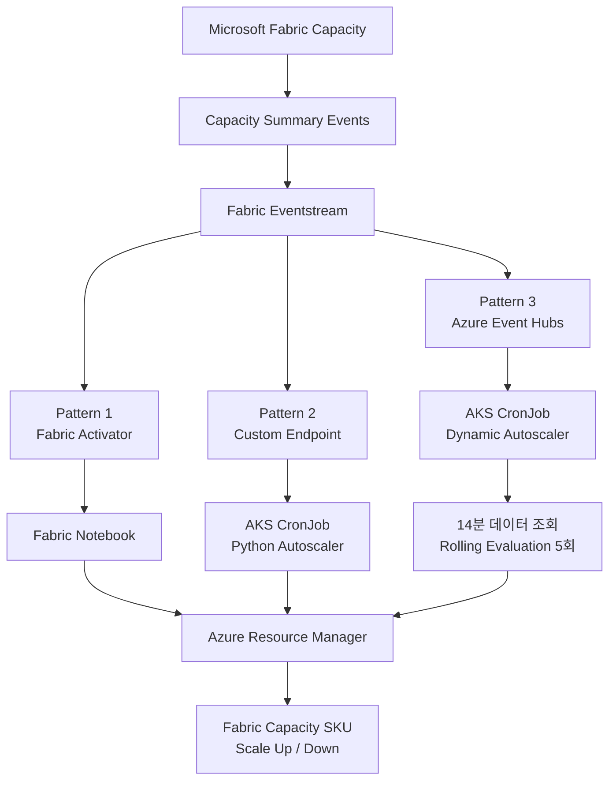
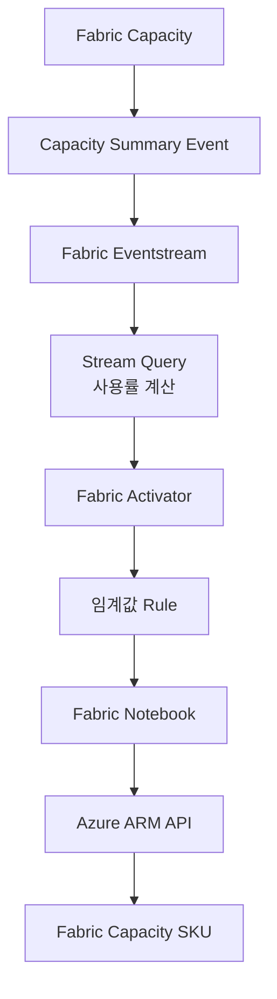
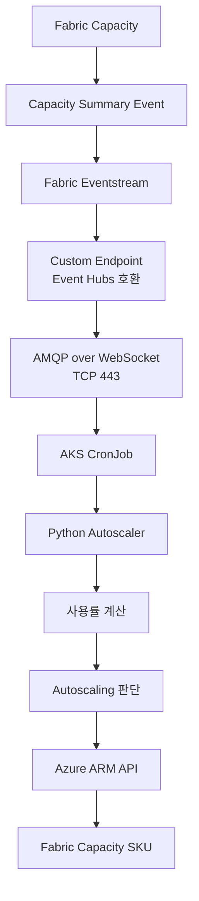
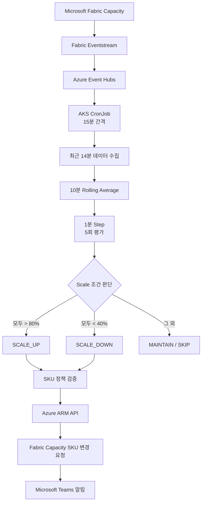
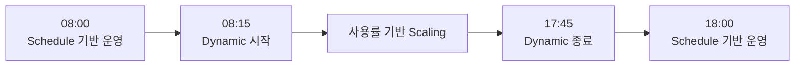
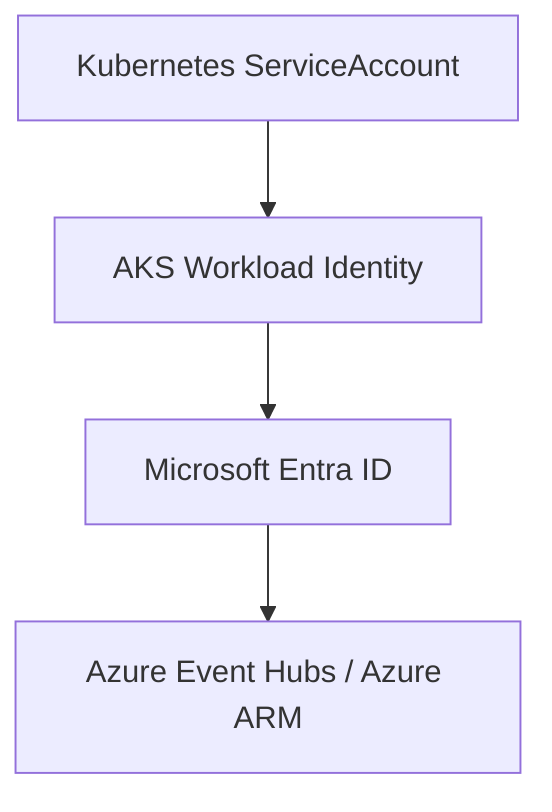
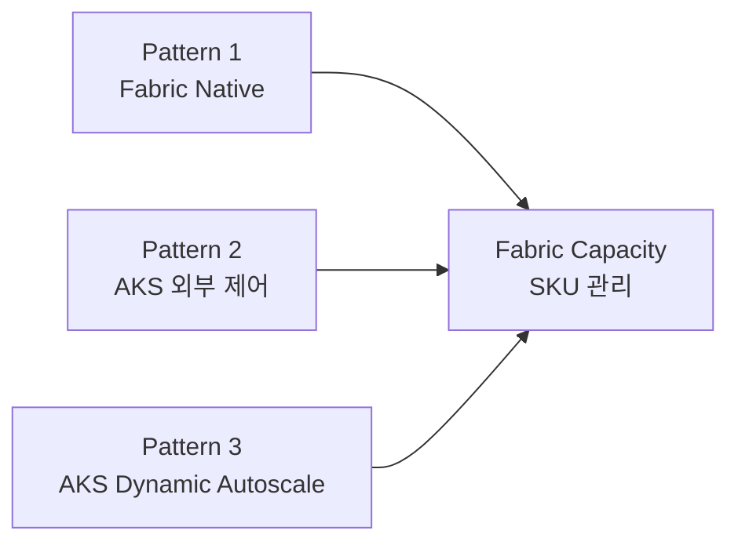

# Microsoft Fabric Capacity Autoscaling Patterns

[English](README.md) | **한국어**

이 저장소는 **Microsoft Fabric Capacity 사용률을 기반으로 Capacity SKU를 자동 조정하기 위한 Autoscaling 아키텍처 패턴과 개념 검증(POC) 구현 사례**를 정리한 프로젝트입니다.

Microsoft Fabric Real-Time Intelligence에서 제공하는 Capacity 이벤트를 활용한 세 가지 접근 방식을 소개하고 비교합니다.

1. **Pattern 1 — Eventstream + Activator + Notebook**
2. **Pattern 2 — Eventstream Custom Endpoint + AKS CronJob**
3. **Pattern 3 — Event Hubs + AKS Dynamic Autoscale**

세 가지 패턴 모두 Fabric Capacity 이벤트를 사용률 지표의 데이터 소스로 사용합니다. 다만 **사용률을 분석하는 위치, Autoscaling 조건을 평가하는 위치, 실제 Scale 작업을 실행하는 방식**에서 차이가 있습니다.

---

## 1. 개요

Microsoft Fabric Capacity는 사용률 및 상태 정보를 이벤트 형태로 제공할 수 있습니다.

이 프로젝트에서는 다음 이벤트 유형을 주요 Autoscaling 지표 데이터 소스로 사용합니다.

```text
Microsoft.Fabric.Capacity.Summary
```

Capacity Summary 이벤트에는 다음과 같은 정보가 포함될 수 있습니다.

```text
capacityName
capacitySku
capacityRegion
baseCapacityUnits
capacityUnitMs
windowStartTime
windowEndTime
utilizationBackground
utilizationInteractive
interactiveDelayThresholdPercentage
interactiveRejectionThresholdPercentage
backgroundRejectionThresholdPercentage
overageTotalCapacityUnitMs
```

이러한 필드를 활용하여 Fabric Capacity 사용률을 계산하고, 환경별 정책에 따라 Scale Up 또는 Scale Down 여부를 결정합니다.

### Autoscaling 패턴 비교

| 구분 | Pattern 1 | Pattern 2 | Pattern 3 |
|---|---|---|---|
| 아키텍처 | Activator + Notebook | Custom Endpoint + AKS | Event Hubs + AKS Dynamic Autoscale |
| 사용률 계산 | Fabric Eventstream | Python | Python |
| Scale 판단 | Fabric Activator | Python | Python Rolling Average |
| 실행 모델 | 이벤트 기반 | 스케줄 기반 One-Shot | 스케줄 기반 One-Shot |
| 제어 영역 | Microsoft Fabric | AKS | AKS |
| Capacity 변경 | Azure ARM API | Azure ARM API | Azure ARM API |
| 주요 특징 | Fabric Native | 외부 제어 영역 | 정책 기반 Dynamic Scaling |

---

## 2. 아키텍처 패턴

세 가지 패턴은 모두 동일한 Fabric Capacity Summary 이벤트를 기반으로 구성됩니다.



### 아키텍처 상세 비교

| 항목 | Pattern 1 | Pattern 2 | Pattern 3 |
|---|---|---|---|
| 지표 데이터 소스 | Capacity Summary Event | Capacity Summary Event | Capacity Summary Event |
| 이벤트 처리 | Eventstream | Eventstream | Eventstream |
| 이벤트 소비자 | Activator | AKS Python | AKS Python |
| Scale 트리거 | Activator Rule | CronJob | CronJob |
| 사용률 평가 | Activator Window | 애플리케이션 로직 | 10분 평균 × 5회 |
| ARM API 실행 위치 | Notebook | AKS | AKS |
| Kubernetes 필요 여부 | 불필요 | 필요 | 필요 |
| Notebook 세션 필요 여부 | 필요 | 불필요 | 불필요 |
| 운영시간 정책 | Rule 설정에 따라 결정 | 구현 방식에 따라 결정 | 평일 08:15~17:45 KST |
| Teams 알림 | 구현 방식에 따라 결정 | 구현 방식에 따라 결정 | 지원 |

Pattern 2와 Pattern 3은 모두 AKS를 사용합니다.

다만 **Pattern 3은 운영시간 제한, Rolling Average 계산, 연속 임계값 평가, 환경별 SKU 범위, Teams 알림을 포함한 구체적인 Dynamic Autoscale 구현에 중점을 둡니다.**

---

## 3. Pattern 1 — Eventstream + Activator + Notebook

📁 [`Fabric Eventstream Activator Notebook`](./Fabric%20Eventstream%20Activator%20Notebook/)

이 패턴은 Microsoft Fabric Real-Time Intelligence 서비스를 중심으로 Autoscaling을 구현합니다.



Eventstream은 `Microsoft.Fabric.Capacity.Summary` 이벤트를 처리하고 사용률을 계산합니다.

Activator에서는 다음과 같은 Window 기반 규칙을 설정할 수 있습니다.

```text
Window Size  : 10분
Step Size    : 1분
Time Elapsed : 5분
```

임계값 설정 예시:

```text
Scale Up   : 사용률 > 60%
Scale Down : 사용률 < 30%
```

설정된 조건이 지정된 시간 동안 지속되면 Activator가 Fabric Notebook을 트리거합니다.

Notebook은 Activator에서 전달된 파라미터를 수신하고, 현재 Capacity 상태와 SKU를 확인한 후 Azure ARM API를 통해 SKU 변경을 요청합니다.

### 주요 특징

- Fabric Native 아키텍처 기반 Autoscaling
- 이벤트 기반 임계값 평가
- Activator의 Window / Step / Time Elapsed 기능 활용
- 별도의 Kubernetes 이벤트 소비자 불필요
- Fabric Notebook을 통한 Azure ARM API 연동
- Notebook 세션 초기화 시간 고려 필요

---

## 4. Pattern 2 — Eventstream Custom Endpoint + AKS CronJob

📁 [`Fabric Eventstream Custom Endpoint`](./Fabric%20Eventstream%20Custom%20Endpoint/)

이 패턴은 Autoscaling 제어 영역을 Microsoft Fabric에서 분리하여 AKS에서 실행합니다.

Fabric Eventstream이 Capacity 이벤트를 제공하고, AKS CronJob은 Event Hubs 호환 Custom Endpoint를 통해 이벤트를 수신하여 Autoscaling 로직을 실행합니다.



Custom Endpoint에서는 다음 연결 정보를 제공합니다.

```text
Event Hub Namespace Endpoint
Event Hub Name
Consumer Group
```

Azure Event Hubs Python SDK를 사용한 연결 예시:

```python
client = EventHubConsumerClient(
    fully_qualified_namespace=EVENTHUB_NAMESPACE,
    eventhub_name=EVENTHUB_NAME,
    consumer_group=CONSUMER_GROUP,
    credential=DefaultAzureCredential(),
    transport_type=TransportType.AmqpOverWebsocket,
)
```

CronJob은 지속적으로 실행되는 이벤트 소비자가 아니라 **One-Shot Batch 프로세스** 형태로 동작합니다.

### 주요 특징

- Autoscaling 제어 영역을 Fabric에서 분리
- 기존 AKS CronJob 인프라 재사용
- Fabric Notebook 세션 불필요
- Microsoft Entra ID / AKS Workload Identity 인증
- Event Hubs 호환 Custom Endpoint 사용
- AMQP over WebSocket / TCP 443 통신
- Python 기반 Autoscaling 정책 구현

---

## 5. Pattern 3 — Event Hubs + AKS Dynamic Autoscale

📁 [`Fabric Eventhub Dynamic Autoscale`](./Fabric%20Eventhub%20Dynamic%20Autoscale/)

**Pattern 3은 Fabric Capacity 사용률을 주기적으로 분석하고, 사전에 정의된 운영 정책에 따라 Capacity SKU를 자동으로 변경하는 Dynamic Autoscale 구현 방식입니다.**

Pattern 2와 마찬가지로 AKS에서 실행되지만, 운영환경을 고려한 운영시간 제어와 연속 사용률 평가 로직을 추가한 것이 특징입니다.

### 아키텍처



### 운영 정책

| 항목 | 설정 |
|---|---|
| 운영 요일 | 월요일~금요일 |
| 운영시간 | 08:15~17:45 KST |
| CronJob 실행 주기 | 15분 |
| 주말 운영 | Dynamic Autoscale 비활성화 |
| 이벤트 조회 범위 | 최근 14분 |
| Rolling Window | 10분 |
| Step Size | 1분 |
| 평가 횟수 | 5회 |
| Scale Up | 5개 평균 모두 80% 초과 |
| Scale Down | 5개 평균 모두 40% 미만 |
| 조건 미충족 | MAINTAIN |
| 데이터 부족 | SKIP |
| STG | F8 ↔ F16 |
| PRD | F16 ↔ F32 |
| SKU 변경 단위 | 한 번에 한 단계 |
| 알림 | Microsoft Teams |

### Rolling Average

예를 들어 CronJob이 15:00 KST에 실행되면 이전 14분 데이터를 수집하고 다음과 같이 계산합니다.

| Step | Window 시작 | Window 종료 |
|---|---|---|
| 1 | 14:46 | 14:56 |
| 2 | 14:47 | 14:57 |
| 3 | 14:48 | 14:58 |
| 4 | 14:49 | 14:59 |
| 5 | 14:50 | 15:00 |

5개의 평균 사용률이 모두 80%를 초과하면 Scale Up을 평가하고, 모두 40% 미만이면 Scale Down을 평가합니다.

CronJob은 15분 간격으로 실행됩니다. 여기서 1분 Step은 **단일 CronJob 실행 내부에서 Rolling Average를 계산하는 시간 간격**이며, CronJob 자체의 실행 주기가 아닙니다.

### 운영 스케줄



Dynamic Autoscale 운영시간은 별도로 스케줄링된 Capacity 관리 작업과의 충돌 위험을 줄이도록 설정되어 있습니다.

### Pattern 3 상세 문서

- [Dynamic Autoscale 가이드 — English](./Fabric%20Eventhub%20Dynamic%20Autoscale/README.md)
- [Dynamic Autoscale 가이드 — 한국어](./Fabric%20Eventhub%20Dynamic%20Autoscale/README.ko.md)

사용률 계산, 운영 정책, 배포 설정, Teams 알림 및 검증 절차에 대한 자세한 내용은 위 문서를 참고하세요.

---

## 6. Capacity 사용률 계산

세 가지 패턴 모두 Fabric Capacity Summary 이벤트의 지표를 사용하여 사용률을 계산합니다.

### 계산식

```text
Capacity Budget (CUms)
    = baseCapacityUnits × Window Duration (ms)

사용률(%)
    = capacityUnitMs / Capacity Budget × 100
```

30초 Window 기준:

```text
사용률(%)
    = capacityUnitMs / (baseCapacityUnits × 30,000) × 100
```

### 계산 예시

```text
baseCapacityUnits = 32
capacityUnitMs    = 465,000
Window            = 30초

Capacity Budget = 32 × 30,000
                = 960,000 CUms

사용률 = 465,000 / 960,000 × 100
       = 48.44%
```

Pattern 3은 이렇게 계산된 이벤트별 사용률을 활용하여 10분 Rolling Average를 계산합니다.

---

## 7. SKU 단계 및 Scaling 정책

Fabric Capacity SKU는 다음과 같은 순서로 구성할 수 있습니다.

```text
F2 → F4 → F8 → F16 → F32 → F64
```

환경별로 허용되는 최소 SKU와 최대 SKU를 정의하는 것을 권장합니다.

### SKU 정책 예시

| 패턴 | 환경 | SKU 범위 |
|---|---|---|
| Pattern 1 / 2 | DEV | F2–F8 (예시) |
| Pattern 1 / 2 | STG | F4–F64 (예시) |
| Pattern 1 / 2 | PRD | F16–F64 (예시) |
| Pattern 3 | STG | F8–F16 |
| Pattern 3 | PRD | F16–F32 |

Pattern 1과 Pattern 2의 SKU 범위는 설명을 위한 예시입니다. Pattern 3은 Dynamic Autoscale 구현에 설정된 정책을 나타냅니다.

실제 SKU 범위는 워크로드 특성, 비용 요구사항 및 운영 정책에 맞게 구성해야 합니다.

---

## 8. 인증

소스코드에 인증정보를 직접 저장하는 대신 Microsoft Entra ID 기반 인증을 사용하는 것을 권장합니다.

### 로컬 개발 환경

```text
DefaultAzureCredential
        ↓
Azure CLI / 개발자 자격 증명
```

### AKS Workload Identity



실제 인증 방식은 패턴 및 실행 환경에 따라 달라질 수 있습니다.

다음 정보는 저장소에 커밋하지 않아야 합니다.

```text
Client Secret
Access Token
SAS Key
Event Hub Connection String
Webhook URL
Production Credentials
```

---

## 9. 네트워크 요구사항

Pattern 2와 Pattern 3은 AKS에서 Event Hubs 호환 Endpoint로의 아웃바운드 통신이 필요합니다.

```text
Direction   : Outbound
Destination : *.servicebus.windows.net
Protocol    : AMQP over WebSocket / TLS
Port        : TCP 443
```

Python SDK에서는 다음 전송 방식을 사용합니다.

```python
TransportType.AmqpOverWebsocket
```

이를 통해 기본 AMQP 포트인 TCP 5671 대신 TCP 443을 이용하여 통신할 수 있습니다.

Capacity 상태 조회 및 SKU 변경 요청을 위해 Azure Resource Manager Endpoint와의 통신도 필요합니다.

Pattern 1은 AKS 이벤트 소비자를 사용하지 않으므로 위 AKS 아웃바운드 설정은 필요하지 않습니다.

---

## 10. 저장소 구조

```text
fabric-capacity-autoscaling-patterns/
├── Fabric Eventhub Dynamic Autoscale/
│   ├── cronjob/
│   ├── src/
│   ├── README.ko.md
│   ├── README.md
│   └── requirements.txt
├── Fabric Eventstream Activator Notebook/
├── Fabric Eventstream Custom Endpoint/
├── README.ko.md
└── README.md
```

위 구조는 현재 저장소의 디렉터리 구성을 나타냅니다.

---

## 11. 어떤 패턴을 선택해야 할까?

### Pattern 1 — Eventstream + Activator + Notebook

다음 조건에 적합합니다.

- Fabric Native 아키텍처를 우선하는 경우
- Autoscaling 로직을 Microsoft Fabric 내부에서 관리하려는 경우
- Activator의 Window / Step / Time Elapsed 기능을 활용하려는 경우
- 별도의 Kubernetes 이벤트 소비자를 구성하지 않으려는 경우
- Notebook 세션 초기화 시간이 허용되는 경우

### Pattern 2 — Eventstream Custom Endpoint + AKS CronJob

다음 조건에 적합합니다.

- 기존 AKS 배치 처리 인프라를 재사용하려는 경우
- Autoscaling 제어 영역을 Fabric 외부에서 관리하려는 경우
- Fabric Notebook 세션 초기화 시간을 제거하려는 경우
- Kubernetes 배포, 로깅 및 스케줄링 시스템을 재사용하려는 경우
- Python으로 사용자 정의 Autoscaling 정책을 구현하려는 경우

### Pattern 3 — Event Hubs + AKS Dynamic Autoscale

다음 조건에 적합합니다.

- 사용률에 따라 Fabric Capacity SKU를 자동으로 변경하려는 경우
- Dynamic Scaling을 평일 업무시간으로 제한하려는 경우
- 단기적인 사용률 변동보다 지속적인 사용률 추세를 평가하려는 경우
- 환경별 최소·최대 SKU 범위를 적용하려는 경우
- Schedule 기반 Capacity 관리와 Dynamic Scaling을 함께 사용하려는 경우
- Microsoft Teams를 통해 Scaling 요청 결과를 모니터링하려는 경우

---

## 12. POC 및 검증 범위

### Pattern 1 — Activator + Notebook

```text
Capacity Summary 이벤트 수집
Eventstream 사용률 계산
Activator Rule 평가
Window / Step / Time Elapsed 설정
Activator 파라미터 전달
Scale Up Notebook
Scale Down Notebook
Azure ARM Capacity SKU 변경
```

### Pattern 2 — Custom Endpoint + AKS

```text
Fabric Eventstream Custom Endpoint
Event Hubs 호환 연결
Microsoft Entra ID 인증
AKS Workload Identity
AMQP over WebSocket / TCP 443
Capacity Summary 이벤트 수신
사용률 계산
One-Shot CronJob 실행
Azure ARM Capacity 연동
```

### Pattern 3 — Dynamic Autoscale

```text
Capacity Summary 이벤트 수신
최근 14분 데이터 수집
10분 Rolling Average 계산
1분 Step × 5회 평가
80% / 40% 연속 임계값 평가
운영시간 및 주말 정책 검증
STG / PRD SKU 범위 검증
Azure ARM SKU 변경 요청
Microsoft Teams 알림
Read-Only 사용률 POC 검증
```

Pattern 3에는 실제 Capacity SKU를 변경하지 않고 Event Hub 사용률 계산 및 Rolling Average 결과를 검증하기 위한 별도의 Read-Only POC 구현이 포함되어 있습니다.

---

## 13. 보안 고려사항

이 저장소는 아키텍처 패턴과 예제 구현을 제공하기 위한 프로젝트입니다.

공개 저장소에는 다음 정보를 포함하지 않아야 합니다.

```text
Subscription ID
Tenant ID
Actual Client ID
Client Secret
Capacity Resource ID
Production Eventstream Endpoint
Production Consumer Group
Webhook URL
Connection String
Private IP
```

환경별 설정은 다음 방법을 통해 관리해야 합니다.

```text
Environment Variables
Kubernetes Secret
Azure Key Vault
Secret Management System
```

운영 로그에는 Capacity 이름, 리소스 식별자 또는 사용률 데이터가 포함될 수 있으므로 공개 전에 검토해야 합니다.

---

## 14. 운영 고려사항

운영환경에서 Autoscaling을 활성화하기 전에 다음 사항을 확인해야 합니다.

- Fabric Capacity 워크로드 및 사용률 패턴
- SKU 변경에 따른 비용 영향
- Scale Up / Scale Down 발생 빈도
- Event Hub 데이터 수집 지연
- Rolling Average 데이터 완전성
- CronJob 동시 실행 및 Schedule 기반 작업과의 충돌
- Azure ARM API 요청 결과
- 실제 SKU 변경 완료 여부
- Capacity 전환 중 서비스 영향
- 실패 처리 및 알림

**ARM PATCH 요청이 접수되었다고 해서 실제 SKU 변경이 완료되었다는 의미는 아닙니다.**

Azure Resource Manager를 통해 최종 SKU와 Provisioning State를 확인하는 것을 권장합니다.

---

## 15. 면책 및 참고사항

이 저장소의 Autoscaling 임계값, SKU 범위, 규칙 지속시간 및 실행 스케줄은 POC 또는 Reference Implementation의 설정값입니다.

실제 운영환경의 요구사항에 맞게 검증해야 합니다.

특히 Pattern 3은 Activator의 Window / Step / Time Elapsed 개념을 참고하여 Python 기반 Rolling Average 계산을 구현한 것입니다. Microsoft Fabric Activator 내부의 모든 동작을 동일하게 재현한다고 보장하지 않습니다.

운영환경에서 자동 SKU 변경을 활성화하기 전에 DEV / STG 환경에서 충분히 검증하는 것을 권장합니다.

---

## 16. 요약

세 가지 Autoscaling 패턴은 동일한 Fabric Capacity Summary 이벤트를 사용하지만, 제어 영역과 실행 모델에서 차이가 있습니다.



- **Pattern 1:** Fabric Native 기반 이벤트 중심 Autoscaling
- **Pattern 2:** 이벤트 기반 지표 수집 + Kubernetes 스케줄 기반 제어
- **Pattern 3:** 이벤트 기반 지표 수집 + Rolling Average + 정책 기반 Dynamic Scaling

적절한 패턴은 조직의 플랫폼 아키텍처, 네트워크 정책, 실행 지연 요구사항, 운영 정책 및 비용 최적화 목표에 따라 선택해야 합니다.

---

## Maintainer

김민서

MegazoneCloud