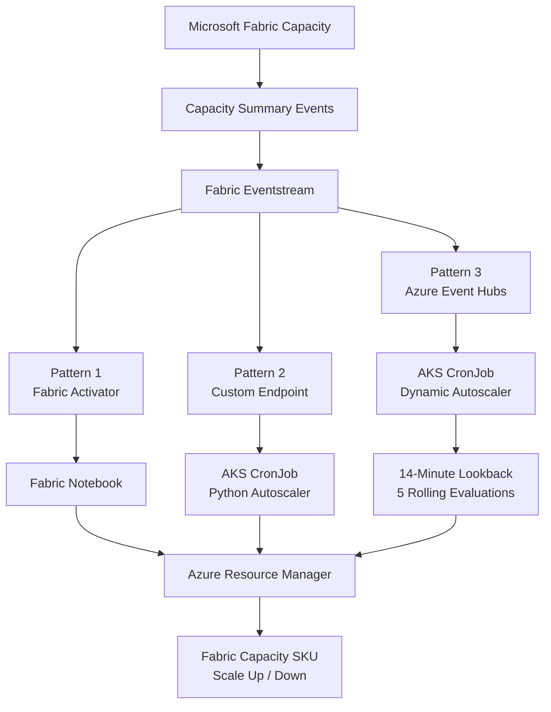
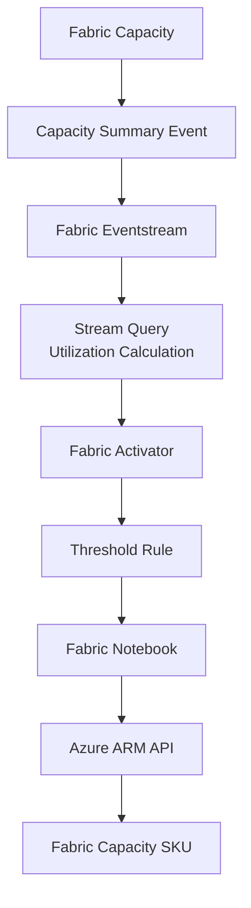
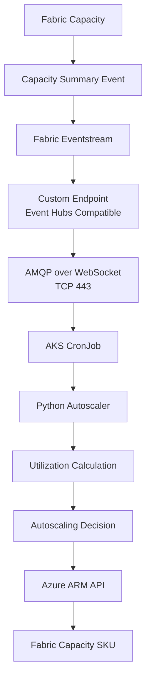
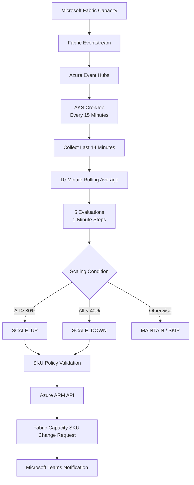
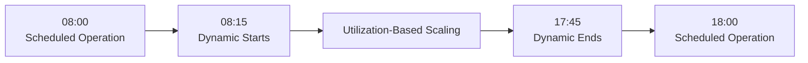
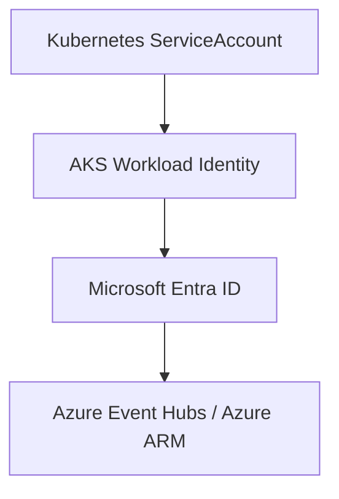
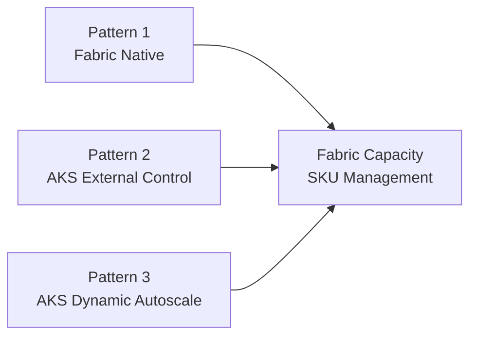

# Microsoft Fabric Capacity Autoscaling Patterns

**English** | [한국어](README.ko.md)

This repository documents **autoscaling architecture patterns and proof-of-concept (POC) implementations for automatically adjusting Microsoft Fabric Capacity SKUs based on utilization**.

It presents and compares three approaches using Capacity events provided through Microsoft Fabric Real-Time Intelligence:

1. **Pattern 1 — Eventstream + Activator + Notebook**
2. **Pattern 2 — Eventstream Custom Endpoint + AKS CronJob**
3. **Pattern 3 — Event Hubs + AKS Dynamic Autoscale**

All three patterns use Fabric Capacity events as their utilization metric source. However, **they differ in where utilization is analyzed, where autoscaling conditions are evaluated, and how scaling operations are executed.**

---

## 1. Overview

Microsoft Fabric Capacity can provide utilization and status information as events.

This project uses the following event type as its primary autoscaling metric source:

```text
Microsoft.Fabric.Capacity.Summary
```

Capacity Summary events may contain the following information:

```text
capacityName
capacitySku
capacityRegion
baseCapacityUnits
capacityUnitMs
windowStartTime
windowEndTime
utilizationBackground
utilizationInteractive
interactiveDelayThresholdPercentage
interactiveRejectionThresholdPercentage
backgroundRejectionThresholdPercentage
overageTotalCapacityUnitMs
```

These fields are used to calculate Fabric Capacity utilization and determine whether to scale up or scale down according to environment-specific policies.

### Autoscaling Patterns

| Category | Pattern 1 | Pattern 2 | Pattern 3 |
|---|---|---|---|
| Architecture | Activator + Notebook | Custom Endpoint + AKS | Event Hubs + AKS Dynamic Autoscale |
| Utilization Calculation | Fabric Eventstream | Python | Python |
| Scaling Decision | Fabric Activator | Python | Python Rolling Average |
| Execution Model | Event-driven | Scheduled One-Shot | Scheduled One-Shot |
| Control Plane | Microsoft Fabric | AKS | AKS |
| Capacity Modification | Azure ARM API | Azure ARM API | Azure ARM API |
| Key Characteristic | Fabric Native | External Control Plane | Policy-Based Dynamic Scaling |

---

## 2. Architecture Patterns

All three patterns are based on the same Fabric Capacity Summary events.



### Architecture Comparison

| Item | Pattern 1 | Pattern 2 | Pattern 3 |
|---|---|---|---|
| Metric Source | Capacity Summary Event | Capacity Summary Event | Capacity Summary Event |
| Event Processing | Eventstream | Eventstream | Eventstream |
| Event Consumer | Activator | AKS Python | AKS Python |
| Scaling Trigger | Activator Rule | CronJob | CronJob |
| Utilization Evaluation | Activator Window | Application Logic | 10-Minute Average × 5 Steps |
| ARM API Execution | Notebook | AKS | AKS |
| Kubernetes Required | No | Yes | Yes |
| Notebook Session Required | Yes | No | No |
| Operating Hours Policy | Depends on Rule Configuration | Depends on Implementation | Weekdays, 08:15–17:45 KST |
| Teams Notification | Depends on Implementation | Depends on Implementation | Supported |

Both Pattern 2 and Pattern 3 use AKS. However, **Pattern 3 focuses on a specific Dynamic Autoscale implementation that includes operating-hour restrictions, rolling-average calculations, consecutive threshold evaluations, environment-specific SKU boundaries, and Teams notifications.**

---

## 3. Pattern 1 — Eventstream + Activator + Notebook

📁 [`Fabric Eventstream Activator Notebook`](./Fabric%20Eventstream%20Activator%20Notebook/)

This pattern implements autoscaling primarily through Microsoft Fabric Real-Time Intelligence services.



Eventstream processes `Microsoft.Fabric.Capacity.Summary` events and calculates utilization.

Activator can evaluate window-based rules with settings such as:

```text
Window Size  : 10 minutes
Step Size    : 1 minute
Time Elapsed : 5 minutes
```

Example thresholds:

```text
Scale Up   : Utilization > 60%
Scale Down : Utilization < 30%
```

When the configured conditions persist for the required duration, Activator triggers a Fabric Notebook.

The Notebook receives Activator parameters, checks the current Capacity state and SKU, and requests a SKU modification through the Azure ARM API.

### Key Characteristics

- Autoscaling based on a Fabric Native Architecture
- Event-driven threshold evaluation
- Activator Window / Step / Time Elapsed functionality
- No separate Kubernetes event consumer required
- Azure ARM API integration through Fabric Notebook
- Notebook session initialization time must be considered

---

## 4. Pattern 2 — Eventstream Custom Endpoint + AKS CronJob

📁 [`Fabric Eventstream Custom Endpoint`](./Fabric%20Eventstream%20Custom%20Endpoint/)

This pattern separates the autoscaling control plane from Microsoft Fabric by running it on AKS.

Fabric Eventstream provides Capacity events, while an AKS CronJob receives them through an Event Hubs-compatible Custom Endpoint and executes the autoscaling logic.



The Custom Endpoint provides the following connection information:

```text
Event Hub Namespace Endpoint
Event Hub Name
Consumer Group
```

Example connection using the Azure Event Hubs Python SDK:

```python
client = EventHubConsumerClient(
    fully_qualified_namespace=EVENTHUB_NAMESPACE,
    eventhub_name=EVENTHUB_NAME,
    consumer_group=CONSUMER_GROUP,
    credential=DefaultAzureCredential(),
    transport_type=TransportType.AmqpOverWebsocket,
)
```

The CronJob operates as a **One-Shot Batch process**, rather than a continuously running event consumer.

### Key Characteristics

- Autoscaling control plane separated from Fabric
- Reuses existing AKS CronJob infrastructure
- No Fabric Notebook session required
- Microsoft Entra ID / AKS Workload Identity authentication
- Event Hubs-compatible Custom Endpoint
- AMQP over WebSocket / TCP 443 communication
- Python-based autoscaling policy implementation

---

## 5. Pattern 3 — Event Hubs + AKS Dynamic Autoscale

📁 [`Fabric Eventhub Dynamic Autoscale`](./Fabric%20Eventhub%20Dynamic%20Autoscale/)

**Pattern 3 implements Dynamic Autoscale by periodically analyzing Fabric Capacity utilization and automatically modifying the Capacity SKU according to predefined operating policies.**

Like Pattern 2, it runs on AKS. However, it adds operating-hour controls and consecutive utilization evaluation logic designed for operational use.

### Architecture



### Operating Policy

| Item | Configuration |
|---|---|
| Operating Days | Monday–Friday |
| Operating Hours | 08:15–17:45 KST |
| CronJob Execution Interval | 15 minutes |
| Weekend Operation | Dynamic Autoscale Disabled |
| Event Lookback | Last 14 minutes |
| Rolling Window | 10 minutes |
| Step Size | 1 minute |
| Required Evaluations | 5 |
| Scale Up | All 5 averages > 80% |
| Scale Down | All 5 averages < 40% |
| Conditions Not Met | MAINTAIN |
| Insufficient Data | SKIP |
| STG | F8 ↔ F16 |
| PRD | F16 ↔ F32 |
| SKU Modification | One level at a time |
| Notification | Microsoft Teams |

### Rolling Average

For example, when the CronJob executes at 15:00 KST, it collects the previous 14 minutes of data and performs the following calculations:

| Step | Window Start | Window End |
|---|---|---|
| 1 | 14:46 | 14:56 |
| 2 | 14:47 | 14:57 |
| 3 | 14:48 | 14:58 |
| 4 | 14:49 | 14:59 |
| 5 | 14:50 | 15:00 |

If all five average utilization values exceed 80%, the application evaluates Scale Up. If all five averages are below 40%, it evaluates Scale Down.

The CronJob runs every 15 minutes. The one-minute step refers to **the rolling-average calculation interval within a single CronJob execution**, not the CronJob execution frequency.

### Operating Schedule



The Dynamic Autoscale operating window is configured to reduce the risk of conflicts with separately scheduled Capacity management operations.

### Pattern 3 Documentation

- [Dynamic Autoscale Guide — English](./Fabric%20Eventhub%20Dynamic%20Autoscale/README.md)
- [Dynamic Autoscale Guide — 한국어](./Fabric%20Eventhub%20Dynamic%20Autoscale/README.ko.md)

Refer to these documents for detailed utilization calculations, operating policies, deployment configuration, Teams notifications, and validation procedures.

---

## 6. Capacity Utilization Calculation

All three patterns calculate utilization using Fabric Capacity Summary event metrics.

### Formula

```text
Capacity Budget (CUms)
    = baseCapacityUnits × Window Duration (ms)

Utilization (%)
    = capacityUnitMs / Capacity Budget × 100
```

For a 30-second window:

```text
Utilization (%)
    = capacityUnitMs / (baseCapacityUnits × 30,000) × 100
```

### Example

```text
baseCapacityUnits = 32
capacityUnitMs    = 465,000
Window            = 30 seconds

Capacity Budget = 32 × 30,000
                = 960,000 CUms

Utilization = 465,000 / 960,000 × 100
            = 48.44%
```

Pattern 3 uses these event-level utilization values to calculate 10-minute rolling averages.

---

## 7. SKU Ladder and Scaling Policies

Fabric Capacity SKUs can be organized in the following order:

```text
F2 → F4 → F8 → F16 → F32 → F64
```

It is recommended to define minimum and maximum allowed SKU boundaries for each environment.

### Example SKU Policies

| Pattern | Environment | SKU Range |
|---|---|---|
| Pattern 1 / 2 | DEV | F2–F8 (Example) |
| Pattern 1 / 2 | STG | F4–F64 (Example) |
| Pattern 1 / 2 | PRD | F16–F64 (Example) |
| Pattern 3 | STG | F8–F16 |
| Pattern 3 | PRD | F16–F32 |

The SKU ranges for Patterns 1 and 2 are illustrative examples. Pattern 3 shows the policies configured in the Dynamic Autoscale implementation.

Actual SKU boundaries should be configured according to workload characteristics, cost requirements, and operational policies.

---

## 8. Authentication

It is recommended to use Microsoft Entra ID-based authentication instead of storing credentials directly in source code.

### Local Development

```text
DefaultAzureCredential
        ↓
Azure CLI / Developer Credential
```

### AKS Workload Identity



The actual authentication mechanism may vary depending on the pattern and execution environment.

Do not commit the following information to the repository:

```text
Client Secret
Access Token
SAS Key
Event Hub Connection String
Webhook URL
Production Credentials
```

---

## 9. Network Requirements

Patterns 2 and 3 require outbound connectivity from AKS to an Event Hubs-compatible endpoint.

```text
Direction   : Outbound
Destination : *.servicebus.windows.net
Protocol    : AMQP over WebSocket / TLS
Port        : TCP 443
```

The Python SDK uses the following transport:

```python
TransportType.AmqpOverWebsocket
```

This allows communication over TCP 443 instead of the default AMQP TCP 5671.

Connectivity to the Azure Resource Manager endpoint is also required to retrieve Capacity state and request SKU modifications.

Pattern 1 does not require an AKS event consumer, so this specific AKS outbound configuration is unnecessary.

---

## 10. Repository Structure

```text
fabric-capacity-autoscaling-patterns/
├── Fabric Eventhub Dynamic Autoscale/
│   ├── cronjob/
│   ├── src/
│   ├── README.ko.md
│   ├── README.md
│   └── requirements.txt
├── Fabric Eventstream Activator Notebook/
├── Fabric Eventstream Custom Endpoint/
├── README.ko.md
└── README.md
```

This structure reflects the current repository directory layout.

---

## 11. Which Pattern Should You Choose?

### Pattern 1 — Eventstream + Activator + Notebook

This pattern is suitable when:

- Prioritizing a Fabric Native Architecture
- Managing autoscaling logic within Microsoft Fabric
- Using Activator Window / Step / Time Elapsed functionality
- Avoiding a separate Kubernetes event consumer
- Notebook session initialization time is acceptable

### Pattern 2 — Eventstream Custom Endpoint + AKS CronJob

This pattern is suitable when:

- Reusing an existing AKS batch processing infrastructure
- Managing the autoscaling control plane outside Fabric
- Eliminating Fabric Notebook session initialization time
- Reusing Kubernetes deployment, logging, and scheduling systems
- Implementing custom autoscaling policies in Python

### Pattern 3 — Event Hubs + AKS Dynamic Autoscale

This pattern is suitable when:

- Automatically modifying Fabric Capacity SKUs based on utilization
- Restricting Dynamic Scaling to weekday business hours
- Evaluating sustained utilization trends rather than short-lived fluctuations
- Enforcing environment-specific minimum and maximum SKU boundaries
- Combining schedule-based Capacity management with Dynamic Scaling
- Monitoring scaling request results through Microsoft Teams

---

## 12. POC and Validation Scope

### Pattern 1 — Activator + Notebook

```text
Capacity Summary Event Collection
Eventstream Utilization Calculation
Activator Rule Evaluation
Window / Step / Time Elapsed Configuration
Activator Parameter Delivery
Scale Up Notebook
Scale Down Notebook
Azure ARM Capacity SKU Modification
```

### Pattern 2 — Custom Endpoint + AKS

```text
Fabric Eventstream Custom Endpoint
Event Hubs-Compatible Connection
Microsoft Entra ID Authentication
AKS Workload Identity
AMQP over WebSocket / TCP 443
Capacity Summary Event Reception
Utilization Calculation
One-Shot CronJob Execution
Azure ARM Capacity Integration
```

### Pattern 3 — Dynamic Autoscale

```text
Capacity Summary Event Reception
Last 14 Minutes of Data Collection
10-Minute Rolling Average Calculation
1-Minute Steps × 5 Evaluations
Consecutive 80% / 40% Threshold Evaluation
Operating Hours and Weekend Policy Validation
STG / PRD SKU Boundary Validation
Azure ARM SKU Modification Request
Microsoft Teams Notification
Read-Only Utilization POC Validation
```

Pattern 3 includes a separate read-only POC implementation for validating Event Hub utilization calculations and rolling-average results without modifying the actual Capacity SKU.

---

## 13. Security Considerations

This repository is intended for architecture patterns and sample implementations.

The following information must not be included in a public repository:

```text
Subscription ID
Tenant ID
Actual Client ID
Client Secret
Capacity Resource ID
Production Eventstream Endpoint
Production Consumer Group
Webhook URL
Connection String
Private IP
```

Environment-specific configuration should be managed using:

```text
Environment Variables
Kubernetes Secret
Azure Key Vault
Secret Management System
```

Operational logs may contain Capacity names, resource identifiers, or utilization data and should be reviewed before public disclosure.

---

## 14. Operational Considerations

Before enabling autoscaling in a production environment, verify the following:

- Fabric Capacity workload and utilization patterns
- Cost implications of SKU modifications
- Scale Up / Scale Down frequency
- Event Hub data collection latency
- Rolling-average data completeness
- CronJob concurrency and conflicts with scheduled operations
- Azure ARM API request results
- Actual SKU modification completion
- Service impact during Capacity transitions
- Failure handling and notifications

**An accepted ARM PATCH request does not necessarily mean that the SKU modification has completed.**

It is recommended to verify the final SKU and provisioning state through Azure Resource Manager.

---

## 15. Disclaimer

The autoscaling thresholds, SKU ranges, rule durations, and schedules in this repository represent POC or reference implementation configurations.

These settings must be validated against the requirements of the actual production environment.

In particular, Pattern 3 implements Python-based rolling-average calculations inspired by Activator Window / Step / Time Elapsed concepts. It is not guaranteed to reproduce every internal behavior of Microsoft Fabric Activator.

Thorough validation in DEV / STG environments is recommended before enabling automatic SKU modifications in production.

---

## 16. Summary

The three autoscaling patterns use the same Fabric Capacity Summary events but differ in their control planes and execution models.



- **Pattern 1:** Fabric-native Event-driven Autoscaling
- **Pattern 2:** Event-driven Metrics + Kubernetes Scheduled Control
- **Pattern 3:** Event-driven Metrics + Rolling Average + Policy-based Dynamic Scaling

The appropriate pattern should be selected based on the organization's platform architecture, network policies, execution latency requirements, operational policies, and cost optimization objectives.

---

## Maintainer

김민서  
MegazoneCloud